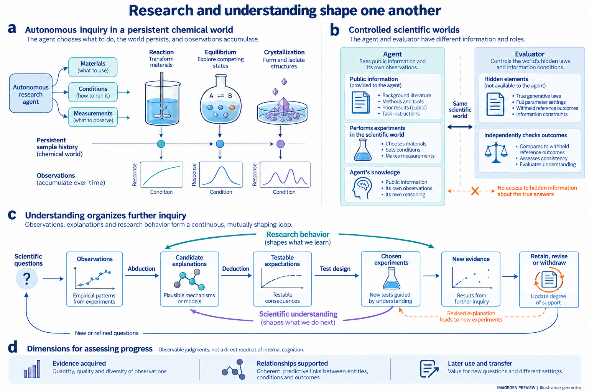
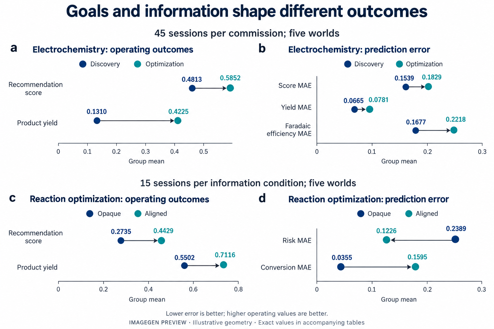
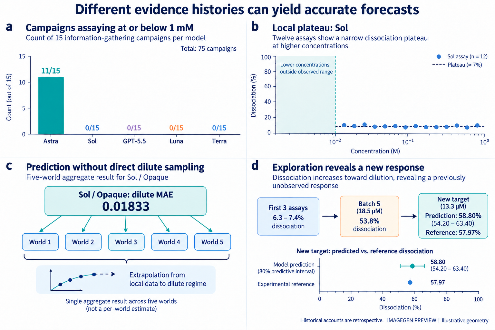
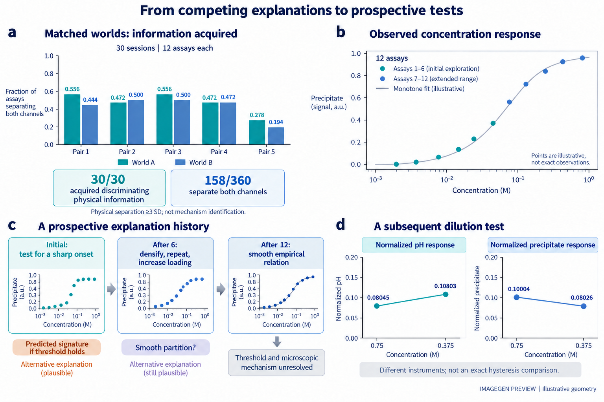
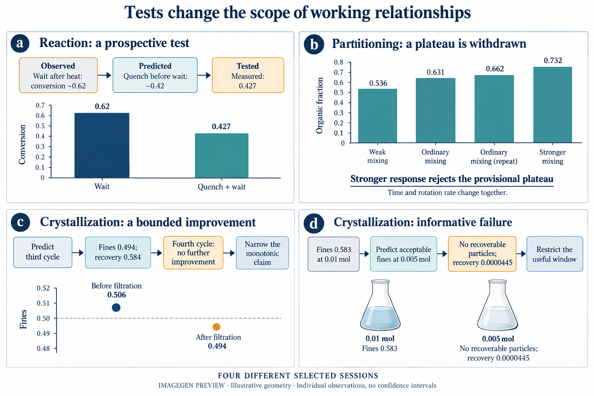
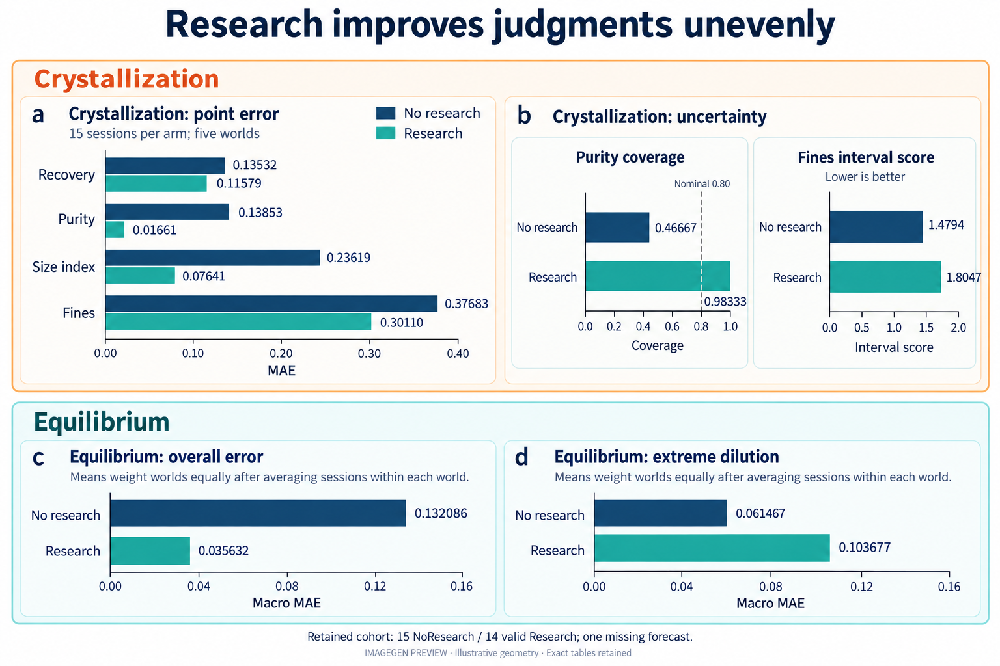

**自主科学的核心承诺，是使实验自主性转化为科学理解的拓展。然而，智能体如何组织探索，并将实验经历转化为知识，仍缺少充分理解。我们提出 ChemWorld，以可编程化学世界结合自主实验和对底层规律、信息供给的独立控制。通过跨化学体系、模型配置与重复研究，我们连接研究目标、先验知识、实验选择、发展中的解释及后续判断。智能体能够提出并检验解释性可能，建立有效的局部关系，并撤回缺少支持的预期。然而，相近的预测准确性可以建立在不同证据经历之上，成功的局部研究也可能留下未决的机制和适用范围。匹配化学世界使实验获得的信息与研究者赋予它的解释得以区分；研究机会比较则考察开展探索的后果。这些研究共同使自主科研本身成为可实证考察的对象，连接探索的组织与科学理解的形成、发展及其对进一步研究的引导。**

科学发现不仅从既有前提推导答案，也提出重新理解现象的观念，并由此开辟新的研究方向。爱因斯坦在1905年狭义相对论论文的开篇指出，磁体与导体相对运动产生的可观察效应，与当时理论描述中的不对称并不相称。他提出新的原理，并推演其对同时性、时间和运动的后果 [@einstein1905electrodynamics]。这一工作体现了科学发现中的创造性活动：重新考察理解世界所依据的前提。

反绎推理关注这一活动中的重要环节：提出值得进一步研究的解释性假设。在皮尔士的科学方法论中，反绎引入可能的解释，演绎展开其可检验后果，经验检验与归纳判断则评估哪些解释应当保留、修订或放弃 [@douven2025peirce]。解释因此既可以是研究的产物，也可以成为进一步探索的起点。实验评价已有判断，同时也可能改变哪些现象需要解释、哪些问题值得继续研究。

自主研究者不仅干预世界，也通过实验与测量的选择，塑造科学判断赖以形成的经历：哪些现象被看见，哪些解释受到检验，哪些结果成为下一次研究的依据。随着 AI 科学家与自驱动实验室连接日益复杂的实验循环，探索的组织本身也成为委托给机器的科学活动 [@tom2024selfdriving; @boiko2023autonomous]。因此，自主科学的承诺既涉及实验能力的扩展，也涉及实验经历向科学认识的转化。

机器人科学家与自驱动实验室已经展示了假说检验、材料发现和反应优化能力 [@king2009automation; @burger2020mobile; @macleod2020selfdriving; @szymanski2023alab]。语言模型智能体进一步连接科学指令、工具与实验操作 [@bran2024augmenting; @dai2024mobile]。这些进展使一个更深的问题进入可研究的范围：智能体自己开展的研究，怎样改变它用来解释和预测世界的关系判断？有效方案构成实验成果，正确预测体现预测准确性；但两者都不能单独说明某项判断从何种证据中形成，以及这些证据支持多大的范围 [@elmachtoub2022spo; @shmueli2010explain]。

困难在于，自主研究者能够获得的证据，本身就是其研究的结果。初始解释可以提出值得执行的实验；观测可以支持、缩小或取代这一解释；形成的判断又可以指导下一次干预。一连串成功实验可能建立有效的局部关系，却未解决它在已观察条件之外是否成立。相反，失败的干预也可以通过排除某项预期而推动认识。考察这种交互，需要连接研究者最初有何理由作出预期、实验实际检验了什么，以及后来把什么当作已经确立的关系 [@platt1964inference; @lindley1956information; @chaloner1995design]。

我们利用 ChemWorld 考察这些联系。核心问题是：当初始信息不足以决定答案时，人工智能如何自主组织探究以发展科学理解，发展中的理解又如何重新塑造探索？四个互补的实验矩阵分别考察研究目标与信息、判断的形成、研究机会，以及匹配化学世界的判别。它们共同覆盖六类化学体系，将重复结果与完整公开研究经历连接起来。历史模型与预算比较则补充不同探索路径。这些证据区分实验取得了什么成果、支持了什么关系，以及这些关系如何进入进一步研究。

## 使自主科学探索成为可检验的研究对象

ChemWorld 将材料、操作与仪器组合为遵循热力学、动力学和耦合过程关系、具有持续状态的虚拟化学系统。反应、热处理、相平衡、分离和结晶组件可以连接为多阶段流程。样品状态持续保留，上游反应或热历史因而能够改变后续分离与测量。智能体在固定资源范围内，自主决定投料、处理顺序、测量、重复及后续实验。这些选择既决定所开发的方案，也决定据以推断的观测。评估者独立控制世界参数和公开信息，记录实际提交的操作，并获得封存的参考结果（图 1）。智能体在研究与评估阶段均看不到这些参考真值。

这一安排使研究过程能够被具体考察。知识测试和给定数据任务评价重要的科学能力 [@mirza2025chembench; @majumder2025discoverybench]，交互式发现环境也已连接行动与观测 [@wang2022scienceworld; @jansen2024discoveryworld; @gandhi2025boxinggym; @chen2025physgym]。ChemWorld 在可组合的化学过程中，连接证据选择、不断变化的公开判断及其后续用途。一次请求可能在改变样品之前被拒绝；一项观测也可能只支持局部关系，尚未确定其在其他干预下是否成立。执行记录和独立评估的世界响应使这些区别能够被核对。

整合设计包含四个矩阵、450场计划研究。目标—信息矩阵包括电化学和反应处理各90场：五世界、三种信息条件、两种研究任务、每格三次新会话。过程矩阵包括分配、纯化、水溶液平衡和反应耦合结晶各45场。机会矩阵在平衡和结晶中分别比较研究与无研究，每体系30场。另有30场匹配水溶液世界研究，将实验获得的物理信息与研究者的解释相联系。最新实验块提供300场，另150场保留自此前固定协议。这是一套共同覆盖设计下的不同实验块，并非所有协议完全相同、同时开展的合并试验（扩展数据图 2）。

信息条件改变研究起点。Opaque 保留公开任务和操作契约，不提供额外实例资料；Aligned 提供正确但不完整的信息；MisIndexed 提供指定错配。发现任务侧重研究科学关系，优化任务侧重开发有效方案。各固定实验块内，模型配置、接口和实验额度遵循对应设计。新会话共享固定世界和观测键，模型采样种子不可控。因此，这些比较考察探索的不同起点，不将世界或重复视为一般科学活动的独立抽样。

新增300场全部到达终态：288场完成全链，298场提供有效预测，完成3,420次计划源终检中的3,379次。十场纯化研究耗尽材料，缺少41次终检；两场反应研究的预测缺失或无效。不完整源经历中的有效预测仍保留，并标明缺口。四场服务中断经技术补跑解决，中断尝试保留；科学失败不予替换。新记录包含873版笔记和31,922条公开操作，均结合可用封存说明和预测完成精读，核对1,363处引文锚点。这些数量说明覆盖范围，不是发现率或反绎成功率。

笔记定位观测前后的判断。研究结束后，智能体封存科学说明，在不能访问实验室的条件下预测十二种新干预，随后在没有参考真值反馈时反思。我们追踪现象、实际提出的解释或预期、拟议检验、真实操作、后续修订及用途；终点修订和未执行计划也保留。全过程区分三件事：编程世界中真实成立什么，当时可用信息支持什么，以及研究者后来提出或采用什么。五模型平衡比较与预算研究等历史证据提供额外参照，不扩大当前矩阵分母。

匹配世界矩阵进一步检验信息与解释的区别。五对水溶液世界共享公开背景和部分参数，但沉淀是否耦合额外中性水相离子对不同。两次给定极稀测定的底层响应接近；自主改变投料、稀释和尺度则可以显露更大差异。30场完整研究产生360次终检和80版笔记。将各自选择的行动序列在配对世界中回放，每场均至少取得一次在两个响应通道上相差三个测定标准差的观测。这说明实际获得了物理区分信息，不等于唯一机制识别，更不等于30次成功反绎。

## 科学探索的自主组织与适应

研究从目标与信息出发，其科学内容则在由此引出的选择中发展。重复电化学矩阵使这一差别可见（图 2a、b）。先在世界内平均会话、再对五世界等权汇总，优化相较发现任务将推荐复测分数从0.4813提高到0.5852，选择性产物产率从0.1310提高到0.4225。然而，分数预测误差从0.1539增至0.1829，产率从0.0665增至0.0781，法拉第效率从0.1677增至0.2218，后三者方向均见于五个世界。这说明有效方案的开发与新干预的判断可以分离，尚不能据此认定操作成功本身造成误解。

过程记录显示成果与局限怎样出现。一位优化研究者在已测幅值上发现负电位优于正电位，继而沿负侧改进材料与时长；终末笔记明确拒绝将结果称为普遍极性规律。其后预测却仍把未测试的正电位内部区域赋予近底噪响应，对应区间未覆盖参考。另一场优化研究则事前挑战绝对极性特异性，执行匹配反向检验并取得0.384产率，将解释改为极性优势而非绝对排他，预测也保留反向产物。因此，优化任务同样可以包含真实解释检验，汇总比较不意味着所有优化都在自我确认。

信息对研究后果的影响也有类似分化（图 2c、d）。在反应优化任务中，Aligned 相较 Opaque 将推荐分数从0.2735提高到0.4429、产率从0.5502提高到0.7116；风险预测误差由0.2389降至0.1226，转化率误差却由0.0355增至0.1595。四个方向均见于五个世界。这比较的是完整信息包，不能单独归因于一句提示，也未识别唯一中介判断。将反应各响应合为单一误差均值，会掩盖这一分化。

中间结果还会改变下一步值得做什么。一位纯化研究者已有纯度0.814、回收0.0479的无洗方案；另一高相量方案回收更高，但纯度为0.7886。它在下一批之前预计0.005 L洗涤可使后者超过0.80，并规定只有回收也超过0.0479才重复这个替代方案。实际洗涤后纯度0.8013、回收0.0441，于是下一批回到原无洗方案做重复，得到0.8149和0.0368。实验部分实现科学预期，却未达到事前行动标准；下一选择遵循了这一区别。重复也显示了波动，并未建立全局最优。

一种解释还可以改变后来能够取得的证据。另一位纯化研究者在低回收后怀疑遗漏投料组分，随后通过两种操作添加实际消耗同一共享库存的物料。改变后的流程耗尽库存，阻止了后来计划的温度实验。终末说明正确承认这些未完成实验不能支持温度关系。在这里，候选解释进入行动，行动改变资源，资源改变剩余观测机会。这是认识塑造探索的一条可见路径，尽管解释同时涉及化学与操作语义。

不同经历也可以形成相近准确性的判断。在历史五模型平衡比较中，Astra的15场有11场对名义浓度不高于1 mM的正投料样品测定，Sol、GPT-5.5、Luna和Terra则各15场均无此测定（图 3）。一场Astra先观察到6.3–7.4%的解离，随后进入18.5微摩尔浓度条件，观察到53.8%。其说明区分局部平台与稀释响应，并对13.3微摩尔条件预测58.80%，80%区间为54.20–63.40%，参考均值为57.97%。Sol/Opaque则未直接采样该区域，却取得0.01833的极稀宏平均误差。获得新现象与成功外推是不同成就；有效推断不要求直接采样每个目标。这些历史观察描述特定研究，并非固定模型性格。

匹配化学世界显示解释性可能如何组织更具体的证据获取（图 4）。一位研究者提出，尖锐沉淀起点与缓冲的溶解响应将支持溶解度限制解释，平滑变化则也容许经验分配描述。六次测定后，它提出更密集的浓度采样、中心重复与递增投料，随后六批确实执行。最终保留平滑单调关系，却未区分展宽阈值与经验分配解释；其预测说明也明确依据未解析出尖锐阈值的平滑单调浓度响应。

另一场检验稀释是否逆转高投料响应。研究者将名义浓度从0.75降至0.375 M，归一化pH从0.08045升至0.10803，终末沉淀信号为0.08026，稀释前测量为0.10004。它支持近似可逆，同时保留小幅滞后的不确定性。最接近的独立制备参照为0.4 M，沉淀读数又来自不同仪器，因此并非精确滞后测定。其科学进展在于明确替代可能成为前瞻检验，再形成适用范围有限的判断。

## 科学认识在实验中的形成与演变

当一项关系接受检验，并改变研究者准备提出的主张或采取的行动，研究的科学内容就变得可见。在反应处理中，一位研究者发现加热后等待期间虽然降温约44 K，转化仍继续。它在下一次比较前预测，同样等待之前先淬灭，将使转化停留在约0.42，而非未即时淬灭时的约0.62。实际检验得到0.427。这连接了偏离预期的观察、可检验解释与成功局部预测（图 5a），但并未确立后来所有溶剂或温度外推。

另一场反应研究区分化学进展与处理结束时报告的风险。事前提出的淬灭对照改变末态风险，化学作用仍未确定；研究者相应收窄结论，并将末态关系用于后续预测。另一个410 K时长序列观察到转化上升、选择性下降，产率在中间时长达到较高值。研究者保留局部权衡，但未确定反应网络拓扑。因此，有效科学理解可以先表现为受约束的关系，而非已经唯一确定的机制。在本实现中，淬灭改变温度、风险与时钟，但不积分额外化学反应；淬灭前等待才继续反应。不同仪器之间的读数差本身也不能确立期间发生的化学过程。

前瞻检验失败也能收窄解释。在分配研究中，一位研究者明确将普通混合条件下接近平台视为暂定判断。弱混合的有机相分数为0.536，普通混合为0.631和0.662，更强条件则为0.732。更强条件推翻了平台预期，后续说明予以撤回（图 5b）。由于时长和转速同时改变，证据支持修订混合关系，尚未分别确定两者作用或唯一传质机制。

结晶提供成功与失败的不同后续（图 5c、d）。一位研究者事前提出增加第三次热循环，实际得到细粉0.494、回收0.584；第四次未继续改善，因而收窄了单调收益预期。过滤前细粉测量为0.506，也说明后来略低于0.50的数值并不是稳健跨阈值证据。另一场降低试剂投料，将细粉降至0.583，随后预计进一步降到0.005 mol即可合格。实际下一批却没有可回收颗粒，过滤回滚，终检回收仅0.0000445。说明因而将有效区域收窄为兼顾细粉与回收的局部窗口，并承认没有合格批次。这里的科学修订并不依赖最终操作成功。

这些过程补充了此前修正版结晶中降低投料形成局部收益、溶剂体积插值失败后明确撤回的案例。它们也显示，合适的研究单位是具体判断，而非整场研究。正确撤回稀释预期的那一场，在另一处却描述了一次失败的1 g晶种检验，而实际只提交0.05 g。合理修订与缺少依据的经验前提可以共存。科学术语、任务成功或假说数量都无法单独区分两者。

经历的重建本身也具有后果（扩展数据图 6）。一场反应研究的两次600 s加热均回滚，没有实际反应时间或温度变化；终末说明却把它们当成1,200 s不反应，提出诱导期或历史效应，并带入后续预测。另一场则明确将回滚加热排除在化学解释之外。在结晶中，一版中途笔记同样把实际提交的0.05 g晶种写成已检验1 g，并据此安排1.5 g检验。高剂量请求继续失败，说明却进一步描述更大已测剂量。新15场研究中八场存在与被拒加种相关的剂量误述，但发生时点和后续用途不同。这是具体的执行—说明差异，尚非一种统一心理机制。

解释这些错误必须核对实际实验。一些返回信息外层称实验完成，内部物理转移却回滚；不同操作也具有不同许可上限。一场反应研究把控制器430 K上限套用到公开允许470 K的直接加热，随后对预期回滚的请求给出近零响应。这些情况涉及操作语义、记述证据与科学判断，不能全部归为化学动力学误解。反过来，终末错误说明也不能被假定指导了此前源研究。我们区分中途前提及其后续行动，与研究结束后首次出现的解释。

即使没有错误执行历史，局部支持与后续应用也会分离。一位反应研究者重复360 K、3,600 s方案，得到分数0.34983和0.34779，并发现延长加热提高转化、降低产率。这支持局部时长权衡。后来它将严重产物损失外推到未测试条件，转化误差仅0.00345，产率误差却为0.31812。准确转化不能验证整套产物损失解释。平衡研究A中，真实解离平台同样进入极稀预测，尽管研究者承认该区域未测试（扩展数据图 5）。其原拟议投料身份对照也未实现，因为两种命令加入同一物种。经验平台与拟议解释因此具有不同证据地位。

这些案例共同显示研究转化为理解的多个环节：观察引出候选，候选选择检验，结果支持或收窄关系，关系进入下一判断。一个环节可以对某项主张成功，对另一项失败。失败检验能够产生合理修订，机制未决能够与有效局部认识共存，正确局部关系也可能获得无依据的更广应用。追踪这些区别，使研究的科学内容超越最终报告是否正确而变得可见。

## 自主探索中科学进展的性质与条件

上述经历表明，自主研究包含实质科学活动。机会矩阵进一步考察：在共同初始信息与评估下，获得研究机会究竟改变什么？平衡和结晶均在五个固定世界中比较十二批研究与无源实验，每世界每组三次新会话，全部使用Opaque信息。这估计组织实验、接受反馈和记录判断的完整机会，不单独识别反绎、相对给定数据的自主性或笔记作用。

新结晶比较提供了明确正向证据（图 6a、b）。30场均有有效预测，180次研究终检全部完成。相较无研究，世界等权平均绝对误差在纯度上由0.13853降至0.01661，粒径指数由0.23619降至0.07641，回收由0.13532降至0.11579，细粉由0.37683降至0.30110。纯度的名义80%区间覆盖率从0.46667升至0.98333，同时平均宽度从0.44744缩至0.09743。真实实验经历可以建立并迁移有效的稳定关系；证据未能保留并不是结晶自主研究的普遍描述。

同一比较也区分点准确性与不确定性质量。细粉区间宽度从0.68500缩至0.38450，覆盖率却从0.42778降至0.35556；同时惩罚宽度与漏失的区间评分从1.4794恶化至1.8047，方向见于全部五个世界。平均点预测改善，并不保证不确定性充分体现尚未解决的条件。恰当结论须按响应展开：研究显著改善纯度判断，细粉预测却仍有明显不确定性问题。

保留的平衡比较揭示另一种边界（图 6c、d）。十四份有效研究预测与十五份无研究预测中，总体归一化宏平均误差由0.132086降至0.035632，五世界均改善。然而，事前指定的三个极稀问题误差由0.061467增至0.103677，四世界恶化；其余九题由0.155625降至0.012950。解离贡献极稀宏误差增幅的85.2%。即使允许唯一缺失研究预测取合法范围内任意误差，也不逆转两个汇总方向（方法）。这种区域反转属于特定世界与判断，不是取得证据的必然后果。

先验信息同样没有普遍排序。分配矩阵中，Aligned、Opaque和MisIndexed的相分数误差依次为0.04654、0.05621和0.07700，Aligned优于MisIndexed的方向见于五世界。两个相分数互补，不能视为独立重复。纯化中三种条件的纯度误差相近，约0.152–0.154，回收误差却以MisIndexed最低；十场材料耗尽还改变了实际取得的证据量。结合反应比较，这说明单一信息收益总分会掩盖科学上不同的判断。

历史证据补充了影响这些结果的其他条件（扩展数据图 1）。原Sol平衡研究中，正确部分信息将九题误差由0.01008降至0.00465，却将三个极稀问题由0.01833增至0.15862；保留重复队列方向相同、幅度不同，分别为0.00907至0.00512和0.09880至0.13205。其他模型配置并非都发生这一反转。历史十二批与二十四批比较也出现某些预测改善，但可行结晶推荐未相应改善。这些独立实验块说明结果依赖研究者、条件及资源范围，并非新矩阵的额外重复。

互补的源观测诊断则考察：已有证据在多大程度上约束了后续判断。在修正过程队列42份有效预测中，智能体纯度误差0.03853，自身源观测均值为0.00510；回收却相反，为0.10129对0.20443，智能体在39场更优（扩展数据图 3）。这些仅用源观测的计算诊断特定经历中未充分使用的信息，不是无研究对照，也不说明实验没有价值。新机会比较确立了相对无研究的显著纯度收益，旧诊断则说明研究者仍可能未充分使用已有证据。两者可以同时成立，无需合并队列或赋予相同基线。

最后，匹配世界研究在一些解释仍未确定时，取得归一化pH误差0.00196、游离解离分数0.00312、沉淀0.00243。经验建立的关系可以支持准确后续推断，而不必先唯一识别机制。该实验块没有无研究组，化学规律也不同，因此低误差不是相对于此前世界的因果改善估计。四矩阵共同显示科学进展具有多个维度：有效流程、受支持的局部关系、成功迁移与可靠不确定性，可以在同一次自主探索中以不同速度发展。

## 讨论

自主研究既改变机器能够遇到的证据，也改变它用来理解证据的关系。四矩阵从互补层次连接这一相互作用：目标与信息改变探索起点，完整经历显示候选解释如何成为检验和修订，机会比较测量后续判断变化，匹配世界回放区分物理信息与解释。贡献在于实证考察探索如何产生、限定并应用科学关系，而不仅评价智能体是否完成实验闭环。

反绎使这一过程中的创造性环节更加明确。偏离预期的现象可以提出改变下一实验的解释，如加热后继续反应、沉淀响应和可逆性检验；演绎后果与经验比较随后改变解释的地位。其他有价值的活动包括建立局部关系、重复临界结果、撤回插值预期和识别尚未执行的检验，并非都需要称为反绎。它们的结合显示发展中的理解如何真正参与探索组织，包括检验失败、唯一机制仍未确定的情形。

结果区分真值、证据支持与后续使用。准确预测可能依赖未决解释，受支持的局部关系可能越出其检验范围，研究者也可能取得显著改善却仍未充分利用观测。结晶机会比较尤其明确：研究形成较强的纯度和粒径预测，细粉不确定性仍不可靠。旧源均值诊断考察的是另一个问题——已有证据被利用到什么程度。如果为整场研究赋予单一科学成败标签，这些差别将被抹去 [@shmueli2010explain; @gneiting2007scoring; @ovadia2019uncertainty]。

过程分析进一步定位了取得证据与重建所检验内容之间的区别。被拒请求可能进入后续说明成为已完成实验，也有会话明确排除它们；文字范围限定可能与不遵循该限定的数值预测并存。与此同时，智能体能够用反例放弃绝对主张、修订行动标准、界定有效操作区域。这些是在具体判断上的发展，并非相互排斥的研究者类型。接口语义和公开表述的出现时点，决定了能在多大程度上将其归因于此前研究。

受控比较也限定所能支持的解释。机会比较估计完整研究组合，而非反绎或实验自主性的独立作用；匹配世界回放固定行动，不估计不同反馈如何改变下一选择，物理区分信息也不证明唯一机制识别。目标与信息比较不能认定某条选中经历是汇总差异的唯一中介。另行固定配方的淬灭实验识别物理效果，却不让智能体适应这些反馈（扩展数据图 4）。研究知识形成，并不要求所有设计共享一个自我确认机制，或最终给出成功纠错策略。

证据局限于可编程体系、固定世界，以及重复矩阵中的一种模型配置。新会话不是模型种子受控重复，也非世界规律的独立抽样。公开笔记不能直接读取内部认知，中途笔记缺失限制时序推断。全部新经历均已精读，但示例判断仍为事后选择，解释没有独立人类第二编码者一致性估计。整合覆盖保留不同协议时期和全部科学失败，包括材料耗尽、无效预测。区分化学理解与执行错误时，还须审查虚拟化学和操作接口。这些边界限制普遍性，但不取消已经观察到的检验、修订和按响应分化的效应。

爱因斯坦的开篇问题提示，科学发现可以要求重新考察理解的前提；它不是衡量当前智能体是否重现历史突破的测试。ChemWorld使这一广义活动中更小、具体的过程能够被观察，将实验选择、获得证据、发展解释和后续决定放回同一研究历史。自主科学由此不仅可以通过机器执行了什么来研究，也可以通过行动如何形成可靠、可迁移的理解，以及理解如何使进一步探索成为可能来研究。
