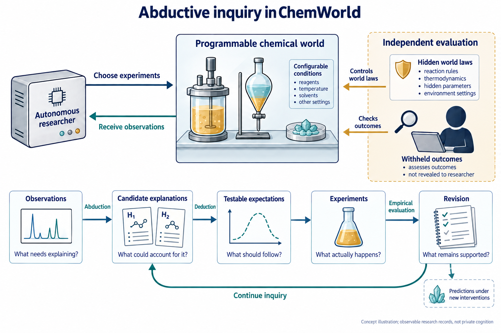

**自主科学要求智能体发展能够指导研究、并经受实验检验的解释。然而，这些解释如何从智能体自身的研究中形成，仍缺少充分理解。我们提出 ChemWorld，以可编程化学世界结合自主实验和对底层规律、信息供给的独立控制。通过跨化学体系、模型配置与重复研究，我们考察反绎探索：候选解释的形成，以及它们通过预测、检验与修订不断发展的过程。智能体能够回应观测、提出替代解释、执行检验、建立局部关系并撤回缺少支持的预期。然而，相近的预测准确性可以来自不同证据经历，有效的局部发现也不保证新干预下的判断可靠。通过连接实验选择、同期记录与后续预测，我们追踪解释如何获得支持，其适用范围又如何在使用中变化；受控的研究机会比较为这些过程记录提供补充。ChemWorld 使自主系统中科学解释的发展成为可实证研究的对象，连接实验自主性与科学认识的形成、修订和适用范围。**

爱因斯坦在 1905 年狭义相对论论文的开篇提出了一个解释上的张力：磁体与导体相对运动所产生的可观察效应，并不要求当时理论描述所赋予的不对称性。他提出新的原理，并借助设想的时钟与光信号，推导其对同时性、时间和运动的含义 [@einstein1905electrodynamics]。这一科学史片段呈现了发现的一项核心要求：将观测联系到解释，展开解释的推论，再使其接受证据约束。其中的智力活动，贯穿识别问题、构建理解方式及检验其后果。

反绎（亦称溯因，abduction）刻画其中一个关键环节：提出值得进一步研究的解释性假说。在皮尔士的论述中，反绎引入候选解释，演绎展开可检验的后果，经验研究则评价并修订这些解释 [@douven2025peirce]。几种推理相互配合。一个猜想在能够提出值得研究的问题、并持续回应观测时，才具有科学上的生产力。因此，需要考察的是持续开展解释性探索的能力：构建关于世界的解释，从中形成预期，并让证据改变这些解释能够支持的判断。

随着 AI 科学家与自驱动实验室承担越来越长的研究过程，这种能力成为一个可实证考察的问题 [@tom2024selfdriving; @boiko2023autonomous]。机器人科学家与自主实验室已经展示假说检验、材料发现和反应优化 [@king2009automation; @burger2020mobile; @macleod2020selfdriving; @szymanski2023alab]，语言模型智能体进一步连接科学指令、工具与实验操作 [@bran2024augmenting; @dai2024mobile]。当智能体获得实验选择权，科学问题也涉及它如何发展组织这些选择的解释。一个自主研究者，能否将未预期的观测转化为候选解释、有信息价值的检验，以及修订后的认识？

困难在于，自主研究者可用的证据，本身就是其探索的结果。解释影响哪些实验看起来值得做，这些实验又决定哪些观测能够支持或挑战解释。有效方案与准确预测都是重要成果，却不能单独说明某项解释如何形成、其证据支持什么 [@elmachtoub2022spo; @shmueli2010explain]。成功实验可以建立局部关系，同时留下机理和更广适用性未决；失败预测也可以通过引出合理修订而推动认识。实验设计和强推断讨论检验如何区分不同可能 [@platt1964inference; @lindley1956information; @chaloner1995design]；自主探索则使这些原则的实际实现成为研究对象。

我们利用 ChemWorld，研究自主研究者如何通过与可编程化学世界交互，形成、检验并发展解释。跨体系比较连接目标、先验信息、研究选择与结果；同期记录追踪预期如何经过观测、候选解释、实际检验与修订；五模型研究呈现从证据走向外推的不同路径；匹配研究机会比较则考察开展研究对后续判断的贡献。这些层次共同连接实验自主性的广度及其产生的科学内容：解释怎样取得实际作用、怎样获得支持，以及怎样被带入研究尚未确定的条件。

## 以可编程世界研究科学推断

ChemWorld 将材料、操作与仪器组合为遵循热力学、动力学和耦合过程关系、具有持续状态的虚拟化学系统。反应、热处理、相平衡、分离和结晶组件可以连接为多阶段流程。样品状态持续保留，上游反应或热历史因而能够改变后续分离与测量。智能体在固定资源范围内，自主决定投料、处理顺序、测量、重复及后续实验。这些选择既决定所开发的方案，也决定据以推断的观测。评估者独立控制世界参数和公开信息，记录实际提交的操作，并获得封存的参考结果（图 1）。智能体在研究与评估阶段均看不到这些参考真值。

这一安排使智能体的研究过程能够被具体考察。知识测试和给定数据任务评价重要的科学能力 [@mirza2025chembench; @majumder2025discoverybench]，交互式发现环境也已连接行动与观测 [@wang2022scienceworld; @jansen2024discoveryworld; @gandhi2025boxinggym; @chen2025physgym]。ChemWorld 进一步在可组合的化学过程中，连接智能体自主选择的证据、不断变化的公开判断及其后续用途。一次操作请求可能在改变样品之前被拒绝；一项观测也可能只支持局部关系，尚未确定其在其他干预下是否成立。执行记录和独立评估的世界响应使这些区别能够被核对。

广度研究包含 Sol 在电化学、分配、反应处理、水溶液平衡、反应耦合结晶和纯化六类体系中的 240 场研究，以及另外四种模型配置的 60 场平衡研究。这些体系支持不同科学问题，包括开发有效的电学或热处理方案、刻画浓度响应，以及在质量约束下回收物料。发现与优化目标、部分先验信息和实验预算，在相应实验块内提供互补比较。每个实验块采用五个固定世界和三种信息条件：Opaque 保留操作契约但不提供额外实例资料；Aligned 提供正确但不完整的信息；MisIndexed 提供指定错配。这些设置改变研究起点，同时保留对应的实验接口。

当前过程分析通过 45 场平衡研究和统一回收定义后的 45 场结晶研究，提高对认识变化的时间分辨率。每个体系覆盖五个固定世界、三种信息条件、每格三次新模型会话。90 场中有 80 条完整研究—评估链、83 份有效预测；不完整会话保留在计划分母中。早期受回收描述不一致影响的结晶会话单独保留。广度研究建立跨体系差异，重复研究则考察具体判断怎样形成，以及如何随研究经历而变化；其协议和分母不合并。

同期笔记将公开判断定位到当时可用的观测。研究结束后，智能体先封存科学解释，再在无法访问实验工具的条件下预测十二个新干预，最后在未获知真值的情况下反思。结构化过程分析在当前 90 场中的 65 场识别出 92 个可观察的“判断—实验—修订”窗口（扩展数据图 1）。其余 25 场在这一记录定义下缺少完整窗口，不能据此认定没有科学学习。另一个同期比较让 30 场新会话在共同评估协议下分别获得或不获得研究机会。贯穿这些证据层，我们分别考察关系与世界结果是否一致、当时有何证据支持，以及研究者后来怎样使用它。

## 研究目标与先验知识组织科学探索

探索始于研究目标、可用信息和受约束的行动空间。历史电化学与反应研究分别要求智能体发展并检验科学理解，或优化公开的操作评分。这些任务产生了实际实验成果，但操作和预测的收益并不可以互相替代（图 2a,b）。30 组匹配的电化学比较中，优化任务在 26 组取得更好的独立复测方案；其中十三组的预测误差更低，另十三组更高。反应处理中，发现任务在三十组中的十七组同时取得更好方案和更准确的评分预测。研究目标与科学后果之间的关系，因而需要结合探索实际建立了什么来理解。

一组电化学研究使这一区别具体可见（图 2c,d）。发现任务先比较材料与条件，再增加时长和电流上限；优化任务先筛选材料组合，再围绕有希望的组合调整操作条件。优化推荐的复测评分为 0.756，高于发现任务的 0.718，但预测平均绝对误差（MAE）为 0.229，高于 0.088。优化研究者在后续预测理由中，将若干表现不佳的交叉材料组合概括为低活性。对于其中一个组合的新条件，它预测 0.070，而参考为 0.494；另一个预测仍准确，为 0.570 对 0.572。这些经历揭示了单一终点评分无法说明的差别：成功开发实验方案，可以与对更广实验空间的不均衡判断并存。

先验信息提供了进入研究组织过程的另一切入口。修正版结晶中，Aligned 条件的十五场均从溶剂 S2、催化剂 C1 开始；没有实例资料的十五场均从 S0、C0 开始。指定错配资料下，十三场从 S2 开始，十四场首先使用 C1。Aligned、Opaque、MisIndexed 的平均实际使用溶剂数分别为 2.93、4.00、2.40。这些描述性差异显示给定信息如何进入材料选择；覆盖更广本身并不证明学习更好。反应处理中，部分参数知识具有明确的预测收益：Aligned 将发现目标的宏平均 MAE 从 0.102 降至 0.057，将优化目标的误差从 0.139 降至 0.084，在两类目标下均于五世界中的四个优于 Opaque。

研究资源也支持不同类型的进展。历史上独立开展的十二批与二十四批研究，在一些电化学、分配和结晶预测上取得改善，却未同步增加合格结晶推荐数或平均复测回收率。这是完整资源范围的比较，不是同一研究经历的匹配继续。结合图 2 的目标比较，它们说明，更有效的操作方案或更大的实验预算，都不能单独说明研究者学到了什么科学关系。

## 解释在猜想、检验与修订中发展

同期记录使我们能够区分继续预定扫描，与回应观测而修订解释。这些活动可能覆盖相近的实验空间。例如，历史电化学发现与优化任务的溶剂覆盖接近，在较大预算下均覆盖全部四种溶剂，操作和预测结果却不同。因此，为考察解释性探索，我们追踪原先预期什么、实际观察到什么，以及研究者随后提出检验什么。

新增研究机会比较中的一条连续轨迹，下文称为“平衡研究 A”，使这一转变具体可见（图 3）。该研究采用 Opaque 信息，没有获得实例专属的档案关系。初始笔记预期弱酸趋势：浓度升高应降低 pH 和解离分数，但前六次实验的解离分数始终约为 0.064–0.079。下一版笔记撤回原趋势在已测范围内的支持，并提出一种可选组分可能比原试剂更直接决定实际酸投料。它同时明确什么结果支持这一解释：系统性的 pH 或解离响应，或沉淀阈值；平坦响应则更支持固定背景或弱耦合解释。第八至十二批实际改用该组分，响应依然接近平台。封存解释保留局部关系，同时没有认定唯一隐藏机制。这在同一研究经历中连接了初始预期、不符观测、候选解释、具有判别意义的预期和真正执行的检验。

这一序列呈现了可观察的反绎活动：偏离初始预期的结果，引出新的解释可能及与之相关的实验。持续存在的平台仍未区分所有竞争机制。因此，证据建立了一段解释性研究和一项有边界的经验发现，尚未唯一识别隐藏规律。这一区别使我们能够在实际达到的层次上评价科学进展。

修正版结晶的 58 个窗口中，52 个所选即时计划与后续实际动作匹配，6 个部分匹配。这刻画可观察窗口中的公开计划—行动联系，不是发现率或写下笔记的作用。结合连续平衡案例，这些记录使探索的适应能够被观察：实验经历可以进入修订后的预期和后续行动。这些行动究竟建立了什么，则需要考察所形成关系的内容与范围。

![图 3 | 平衡研究 A：从修订预期到外推。同一研究会话及其匹配无研究预测的 ImageGen 数据预览。a，前六次测定不支持初始弱酸趋势在当前范围内的适用性。b，新候选解释进入第 8–12 批替代组分检验，响应仍接近平台。c，封存解释中的局部关系随后在极稀预测中获得较大权重，引文为原文。d，研究组预测解离分数 0.085 [0.035, 0.350]，无研究组 0.569 [0.040, 0.980]，封存参考均值为 0.716。区间为研究者给出的 80% 预测区间，源点为单次测定。这是新增研究机会比较的案例，证据包保留完整身份；生成几何为示意。](figures/preview-20261015/figure02.png)

科学关系在支持进一步检验、约束解释或指导新干预时，获得实际研究意义（图 4）。一场修正版结晶研究在获得接近细粉阈值的结果后，事前提出将试剂投料从 0.03 降至 0.02 mol。下一批执行该提议，将细粉从 0.529 降至 0.387，跨过 0.50 阈值。这支持一项局部配方改进。然而，催化剂绝对量保持不变，其相对试剂的比例也随之改变，实验未单独识别浓度机理。所建立的是被测配方与结果之间的有效关系，其支持范围窄于唯一确定的因果定律。

第二场结晶研究检验了一项插值预期。在附近溶剂体积下观察到不同回收和细粉结果后，研究者提出，0.065 L 应保留回收收益并改善细粉。下一次实验却使细粉从 0.512 增至 0.601，最终笔记撤回该预期。因此，失败的操作干预产生了明确回应证据的修订。它与低投料成功检验共同展示实验推进判断的两种方式：建立局部改进，或撤回观测不支持的预测。

一项干预是否实际发生，同样决定能够从中获得什么认识。播种案例 B 计划累计加入约 1 g 晶种，但只有 0.05 g 真正提交，随后十九次请求均被拒绝。后续笔记正确认识到，高剂量检验尚未执行。播种案例 C 遭遇类似拒绝，却将 1 g 描述为已经检验，并据此反对播种解释。这两个案例显示，对同类执行限制可以赋予不同证据意义。额外的热历史和近阈值重复案例保留在补充材料。

这些片段呈现解释性探索的不同组成部分。平衡案例包含对未预期响应的候选解释及其后果检验；结晶案例则显示事前预期、有边界的支持与修订。它们的科学价值在于，观测允许研究者保留或放弃什么。有效干预、获得支持的经验关系和已经识别的机制，是可以区分的成果，都可能进入下一次研究。

## 从局部证据走向外推的不同路径

相同目标与科学条件下，研究路径也会不同。五模型平衡比较允许研究者选择投料、稀释和加料顺序，再预测 pH、解离分数与沉淀。隐藏规律在较高浓度区间产生接近恒定的解离分数，在极稀条件下产生变化。Astra 的十五场研究中，十一场测量了名义浓度不高于 1 mM 的正投料样品；Sol、GPT-5.5、Luna、Terra 各十五场中均没有这样的测量（图 5a）。这一差异描述这些具体研究获得了什么证据，不定义模型固定的探索性格。

一场 Astra 研究展示了新证据的科学用途（图 5d）。前三次测定的解离分数为 6.3–7.4%；第五批测量 18.5 微摩尔每升条件，观察到 53.8%。后续科学解释区分高浓度平台与低浓度响应，并对 13.3 微摩尔每升条件封存预测 58.80%，80% 区间为 54.20–63.40%，参考均值为 57.97%。Sol/Opaque 则沿另一条路径获得准确预测：源研究始终未进入极稀区间，其五世界极稀宏平均 MAE 仍为 0.01833（图 5b,c）。因此，准确预测既可以伴随新响应的直接观测，也可以来自局部观测之外的外推。直接采样每个目标条件并不是成功推断的必要条件。

关键问题在于，这些不同路径究竟建立了什么。外推可以在未直接测量每个目标条件时仍然合理，其支持程度取决于可用理论、观测与尚未解决的替代可能。沿判断的局部证据基础追踪到新的用途，使这一区别具体可见。

同一平衡研究 A 进一步连接合理的局部修订及其后续用途（图 3c,d）。预测极稀条件时，智能体写道：“The point estimate still favors the experimentally supported fixed acidic background”。它给出解离分数 0.085、80% 区间 0.035–0.350，而封存参考均值为 0.716。科学解释与预测都承认该区间未经测试，因此问题比漏写适用范围更具体：局部受支持的关系，在实验尚未确定其延续性的预测中获得较大权重。同一道题的匹配无研究预测为 0.569，区间 0.040–0.980，明确依赖未经检验的先验假设。它在数值上更准确，并不证明其取得了更好的实验发现。

这种延续并非必然。另一个固定平衡世界中的两场研究均在较高投料下观察到平台，极稀宏平均误差却分别为 0.16287 和 0.01462。对于同一道极稀题，它们预测解离分数 0.130 和 0.626，参考均值为 0.65463。较准确的研究采用与平台观测相容的弱酸延续，并明确将其描述为猜想。结合历史 Sol/Opaque 和 Astra 案例，这些记录区分了通向判断的不同路径：观察到的变化、合理外推，以及被带入未决区域的局部关系。数值正确与通过实验确立，仍是不同问题。

平衡体系的先验比较与反应体系的正向结果形成对照。原 Sol 研究中，正确的部分信息将九道题的宏平均 MAE 从 0.01008 降至 0.00465，却将三道最稀题的误差从 0.01833 提高到 0.15862，两个方向在五个世界中均出现。另一个重复队列显示相同的总体方向、不同的幅度：九道题从 0.00907 降至 0.00512，极稀子集从 0.09880 增至 0.13205。两队列分别报告。模型比较进一步限定这一解释（图 6c）：Luna 与 Terra 在两个区域均从 Aligned 获益，GPT-5.5 变化很小，Astra 在三个信息条件下均保持较低极稀误差。部分知识的作用因而同时取决于研究者和被判断的条件；局部收益不能决定它在其他区域的价值。

## 研究改变科学认识的适用范围

随着研究走出解释形成时的条件，其科学作用仍需在新的判断中体现。因此，我们以受控研究机会比较补充已经观察到的推断路径，再按响应考察已获证据如何进入新预测。

匹配的研究机会比较提出更直接的问题：在共同的初始科学信息下，获得研究机会是否改变后续预测（图 7）？三十场均采用 Opaque 信息：公开任务、材料身份、测量尺度、合法操作和初始状态可用，但不提供实例专属档案规律或拟合关系。五个平衡世界各安排三场拥有十二个源批次的新会话，以及三场不开展源实验的新会话。每世界、每重复的科学输入和封存评估相匹配。三十场全部终止，180 个计划源批次全部完成，二十九场提供有效预测。一场研究会话因网络中断缺失预测及后续阶段，其观测和科学解释仍保留。

研究总体上大幅降低了预测误差。先在每世界内平均有效会话，再对五世界等权，归一化宏平均绝对误差由无研究的 0.132086 降至研究的 0.035632，降低 73.0%，五个世界方向一致。然而，在三道事前指定的极稀题上，误差由 0.061467 增至 0.103677，提高 68.7%，五世界中四个恶化；其余九道题从 0.155625 降至 0.012950。比较针对完整研究机会，包括实验选择、反馈和可用记录工具，不分离其中任一成分。

在这一比较中，同一研究机会改善了总体预测，却使特定区域的预测变差。极稀子集中三项响应的平均点误差均增加，幅度不同：研究减无研究的 MAE 分别为归一化 pH +0.00777、解离分数 +0.10795、沉淀信号 +0.01092。解离分数占宏平均误差增量的 85.2%。图 7 展示逐会话与世界均值，完整逐会话、逐响应、逐题结果随稿提供。平衡研究 A 提供从有效局部发现走向远端判断的一条可见路径，不证明它解释每场差异，也不意味着获得更多证据必然损害外推。

这一结果也体现在区间评价中，但不支持普遍的错误自信故事。极稀条件下，研究组的三项名义 80% 区间均有更低的经验覆盖率，无研究区间则宽得多。同时惩罚宽度和遗漏的区间分数，对 pH 更有利于研究，对解离分数更有利于无研究，对沉淀信号相近。在全部题目上，研究均改善三项区间分数。允许缺失会话的宏平均误差取合法范围内任何值的保守敏感性分析，不改变总体获益与极稀恶化两个方向（方法）。

结晶呈现了已获证据使用中的互补情形（扩展数据图 2）。对 42 份有效预测，透明参照仅使用该会话自己的源观测。五世界等权纯度误差，智能体为 0.03853、源均值为 0.00510，后者在每场有效研究中都更准确；回收表现相反，智能体误差为 0.10129，源均值为 0.20443，智能体在 39/42 场获胜。按实际提交的溶剂集合匹配，两个总体方向仍保留。粒径与细粉分别为 5/42、23/42 场优于源均值。这些参照诊断不同响应中对已获证据的使用，不是无研究对照或另一个自主研究者，也不估计结晶研究的因果收益。

这一响应差异补充了平衡结果。挑战不仅在于预见已观察区域之外的变化，也在于保留仍然有效的关系。同一结晶经历中，预测比源均值更有效地利用了变化的回收信息，却未能在稳定纯度上达到这一简单参照。一个响应中的成功证据使用，不证明所有已获关系都同等约束后续判断。贯穿目标、先验、预算和研究机会，科学进展因此具有多个可观察维度：实验取得什么成果，证据确立什么关系，以及这些关系怎样指导新判断。

## 讨论

反绎探索为自主科学提供了具有实质内容的评价对象：解释如何通过研究得到发展。本文连接智能体开展探索的条件、公开提出的假说与关系、实际执行的检验，以及随后形成的判断。跨体系比较显示，操作成功与预测理解可以沿不同方向发展；同期案例则说明，这种分化可以与有意义的科学活动并存，包括提出替代解释、检验局部预期，以及在观测不符时将其撤回。分析的单位是置于研究经历中的解释，以及赋予其科学意义的证据与用途。

结果区分了解释的提出、实验证据支持和成功应用。在平衡研究 A 中，合理的候选解释引出实际检验，却未唯一确定隐藏机制；结晶中，成功的配方变化建立有效干预，同时留下相关原因未决，失败的插值则支持合理撤回。Astra 与 Sol/Opaque 的经历进一步显示，准确预测可以来自对响应变化的直接观察，也可以来自局部证据之外的猜想性延续。这些是不同的科学成果。若将所有实验视为可以互换的数据采集，或将所有正确预测视为等价的发现证据，就会失去这些区别。

这一视角将反绎放回与演绎及经验检验的持续交互中。候选解释为观测提供一种可能说明，其推论指导检验，结果又可以增强、限定或取代该解释。实证记录也呈现这种联系在哪里没有充分建立：被拒绝的操作可能被记为已完成检验，局部规律可能主导尚未解决的外推，已经建立的响应也可能未约束预测。因此，发现与误解可以出现在同一探索的不同环节。考察这些转变，使我们能够同时追问结论是否正确，以及研究者有何理由得出这一结论 [@shmueli2010explain; @gneiting2007scoring; @ovadia2019uncertainty]。

受控比较为这一过程解释提供补充。研究目标、先验信息与可用资源揭示探索的不同条件；匹配机会研究则在共同初始信息下，考察开展研究的总体贡献。其中的总体收益与区域反转说明，科学收益可以随所问问题变化，却不分离反绎、自主性、反馈或笔记的独立作用。固定配方淬灭比较识别干预的物理后果，并未向可适应的智能体反馈结果（扩展数据图 3）。公开判断与行动的时间联系，同样不确立判断形成的唯一因果机制。这些区别使不同比较能够贡献于同一问题，同时保留各自的因果解释范围。

研究限于选定的可编程系统和少数固定世界，重复过程分析采用一种模型配置。新会话不是受控模型 seed 重复，也不是世界规律的独立抽样。公开笔记不揭示内部认知，可观察的解释性活动也不等于发明新的科学理论。该框架组织对已有证据的解释，未新增反绎能力的定量测试。案例事后选择，由单一分析者解释，没有第二编码者一致性估计。历史与当前协议保留各自来源，包括修正版结晶及全部失败。这些边界界定了当前证据支持解释形成、检验与使用的尺度。

更广的研究雄心，是理解一个能够开展实验的系统，如何成为能够发展科学解释的系统。爱因斯坦的例子提出这一智力要求，可编程世界则使其中的具体环节进入受控研究范围。ChemWorld 将智能体提出的解释、据此选择的实验，以及能够改变其世界认识的证据联系起来。科学自主性在这种持续回应中发展：能够追究一种解释，确定它究竟建立了什么，并随探索推进而修订其适用范围。
