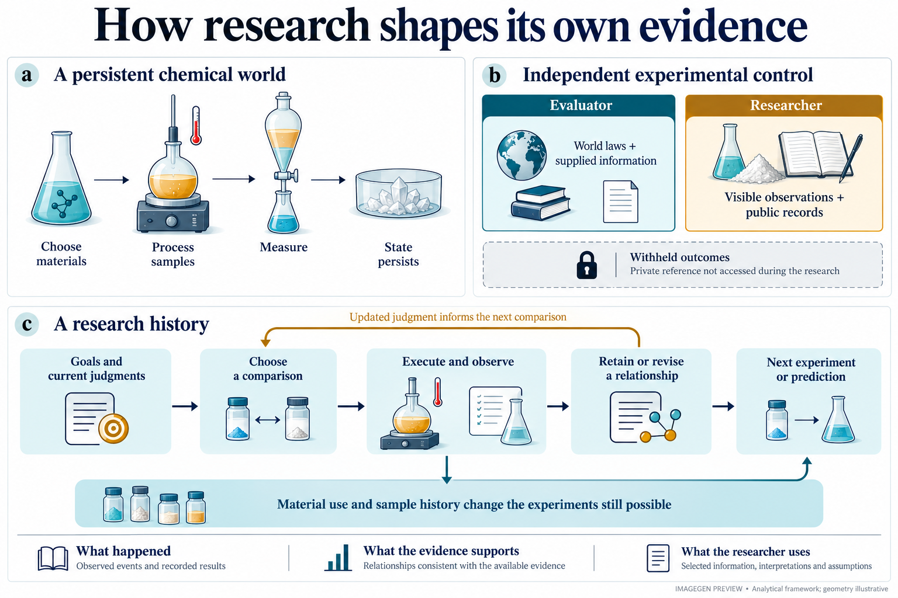
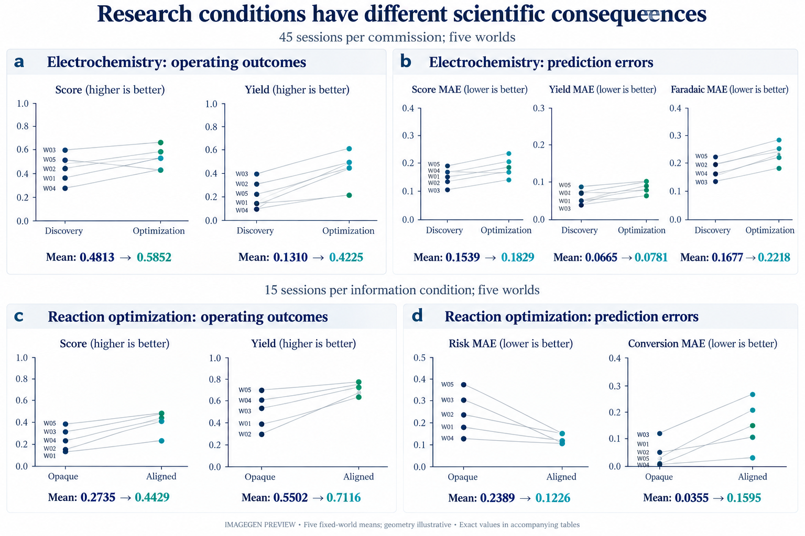
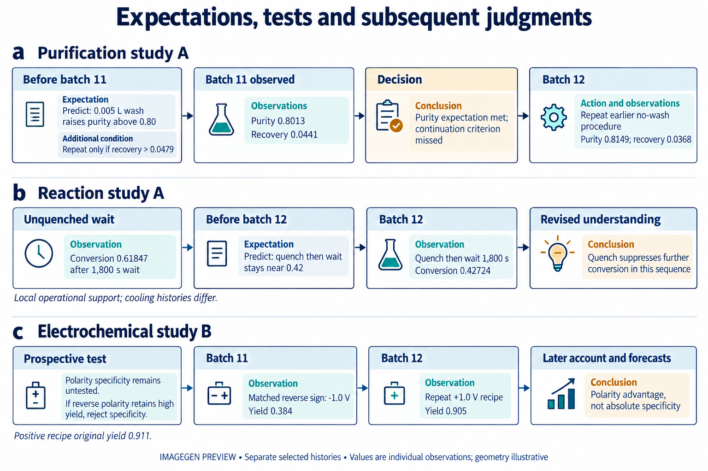
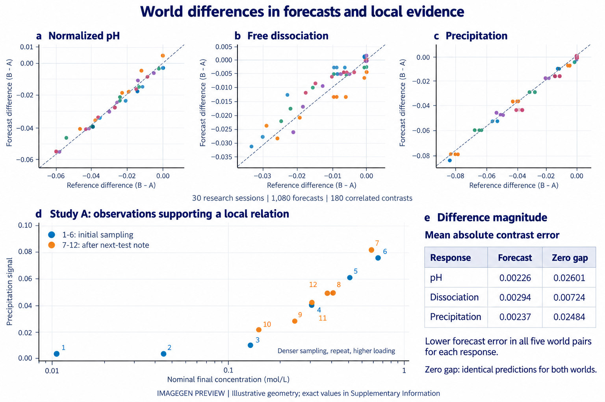

**随着AI Scientist与自主实验室迈向持续运行的科研闭环，机器正从实验执行者发展为自主组织科学探索的研究主体。然而，科学认识如何在自主研究中形成，并引导研究的继续展开，仍缺乏系统理解。我们提出ChemWorld，一组由热力学、动力学及耦合物理化学规律驱动的可编程化学世界，允许独立控制科学规律与信息供给。通过六个化学体系的重复研究、连续记录与受控比较，我们连接研究目标、已有知识、实验选择与不断发展的科学判断。智能体能够将预期转化为实际检验、修订解释并建立有用的关系；匹配世界中的预测也保留了实际化学响应的差异。然而，更有效的实验方案未必带来更准确的预测。结晶研究改善了预测，但智能体与同一批观察的简单均值在不同响应上各有优势；平衡研究的整体预测收益则与极稀条件下的判断恶化并存。这些发现将有用认识的形成与自主探索的组织联系起来，同时表明证据获取、关系形成与后续应用可以取得不同程度的进展。ChemWorld将这些过程纳入受控实证研究，推进了对机器如何通过自主探索产生、修订和运用科学知识的理解。**

AI Scientist与自主实验室正从执行既定操作，发展为能够自主规划实验、检验假说并根据结果调整研究的科学系统[@tom2024selfdriving; @boiko2023autonomous]。机器人科学家、自动化实验室和语言模型智能体，已经展示了材料发现、反应优化与持续实验探索等能力[@king2009automation; @burger2020mobile; @macleod2020selfdriving; @szymanski2023alab; @bran2024augmenting; @dai2024mobile]。然而，能够自主开展实验，并不意味着我们已经理解机器从实验中形成了什么科学认识。有效方案与准确预测，不能单独说明研究建立了哪些认识、这些认识得到什么证据支持，以及它们如何指导进一步探究[@elmachtoub2022spo; @shmueli2010explain]。核心问题因此是：科学认识如何在自主研究中形成，又如何影响后续探索？

自主科研的特殊性在于，研究者通过选择实验参与决定自己能够获得什么证据，并据此形成判断。研究目标和已有知识影响哪些实验被开展，实验选择决定哪些现象变得可见，并改变样品状态与后续研究机会。新的观察又可能支持、限定或挑战已有判断，使尚未解决的关系成为进一步研究的问题[@platt1964inference; @lindley1956information; @chaloner1995design]。科学认识因此既是自主研究的产物，也能够成为进一步组织研究的依据。理解这一过程，需要追踪实验选择、获得的证据、形成的判断及其在后续探索中的运用。

为此，我们提出ChemWorld，一组由热力学、动力学及耦合物理化学模型驱动的可编程化学世界。智能体自主组织实验与测量，评价者则独立控制底层规律与信息供给，并检查实际执行的操作及未公开的参考响应。跨六个化学体系的重复研究，将连续过程记录与受控比较相结合。我们考察研究目标与已有知识如何组织探索，科学关系如何在实验中形成与修订，以及这些认识如何进入后续行动和预测。

研究显示，智能体能够依据观察提出可检验的预期、开展新的比较，并在结果不支持原有判断时修订科学关系。在底层化学不同、起始观察接近的匹配世界中，研究后的预测也反映了实际响应差异。然而，这些进展并不会均匀延伸到后续判断。平衡研究改善了整体预测，却使极稀条件下的判断变差；在结晶研究中，智能体与同一批观察的简单均值，在不同响应的预测上各有优势。自主研究因而能够建立有用的关系，同时留下其适用范围与可靠应用的未决问题。通过连接实验选择、实际获得的证据与不断发展的判断，ChemWorld使科学认识如何形成、修订并继续影响探索，能够得到连续追踪与受控比较。

## 使自主科学探索成为实验研究对象

ChemWorld将材料、操作和仪器组合为由热力学、动力学及耦合过程关系驱动的持续化学世界。反应、热处理、平衡、分离与结晶组件可以连接为多阶段流程。样品状态持续保留：上游反应或热历史会改变下游分离与测量。智能体在固定资源额度内选择数量、处理顺序、测量及后续实验；评价者独立控制世界参数与公开信息，记录实际提交的操作，并获得不向研究者公开的参照结果（图1）。

这一安排使证据选择与证据解释能够共同接受检查。知识测试和给定数据任务考察重要的科学能力[@mirza2025chembench; @majumder2025discoverybench]，交互式发现环境也已经将行动与观察连接起来[@wang2022scienceworld; @jansen2024discoveryworld; @gandhi2025boxinggym; @chen2025physgym]。近期智能体研究还考察了化学结构假说的修订与解释表征的构建[@han2026molquest; @li2026ultradiscovery]。ChemWorld在可组合化学过程中追踪这些研究活动。公开记录确定智能体看见和提出了什么，执行记录确定哪些干预改变了样品，独立世界响应检验后续预测。操作请求可能失败而没有产生预期实验；在一种条件下得到支持的关系，在另一条件下仍可能未决。

研究设计包含四个互补矩阵、450场计划研究。目标—信息矩阵包括电化学与反应处理各90场；过程矩阵包括分配、纯化、平衡和反应耦合结晶各45场；机会矩阵在平衡与结晶中分别比较有研究与无研究，每体系30场；另有30场使用匹配水相世界（方法；扩展数据图2）。

Opaque提供任务与操作合同，不附加实例资料；Aligned提供正确但不完整的信息；MisIndexed提供指定错配。发现任务强调研究科学关系，优化任务强调形成有效方案。世界、接口和额度按各固定块设计保持，每单元有三次独立开启的会话，模型采样随机种子不可控。这些对照规定研究的起始条件，实际路径由智能体组织。

实验结束后，研究者依次封存科学说明、在无实验室访问条件下预测十二项新干预，并在没有真值反馈时反思。我们将同期判断与操作、观察、修订和后续用途连接起来。新增实验块全部300场的公开经历均已阅读，包括不完整经历与失败检验；随后按解释内容选取示例轨迹。研究标签将下文案例与补充材料中的完整记录和关键时点对应。450场设计说明条件覆盖，条件对照估计后果，精选经历定位具体转变而非其普遍发生率。分析始终区分世界真值、当时可用证据与实际采用的判断。

## 科学探索的组织与调整

研究从目标、已有信息和受约束的行动空间出发。智能体选择比较哪些条件、重复哪些流程，以及何时转向新的问题。这些决定同时塑造已经获得的证据与仍可开展的实验。目标和信息对照展示不同起点的后果，连续记录则揭示观察与判断如何进入探索的调整。

在重复电化学矩阵中，相较发现任务，优化任务使世界等权的推荐复测分数从0.4813升至0.5852，产率从0.1310升至0.4225；但分数、产率和法拉第效率的预测误差分别从0.1539、0.0665和0.1677升至0.1829、0.0781和0.2218，三个误差方向均见于全部五个世界（图2a、b）。形成更有效的方案，并不保证对新干预的判断更准确。

信息也产生分化的后果。反应优化任务中，Aligned相较Opaque使推荐分数从0.2735升至0.4429，产率从0.5502升至0.7116；风险预测误差从0.2389降至0.1226，而转化率误差从0.0355升至0.1595，四个方向均见于五个世界（图2c、d）。同一份信息既可以支持更有效的干预和更准确的风险判断，也可能伴随更不准确的转化率预测。

连续记录显示结果怎样进入下一次实验选择。纯化研究A区分了预期的响应与继续某种流程所需的结果（图3a）。无洗流程已得到纯度0.8140、回收0.0479；增加有机相量提高了回收，却使纯度停留在0.7886，低于要求的0.80。第11批之前，研究者预测0.005 L的小体积洗涤可以跨过纯度门槛，并事先规定行动标准：只有回收同时超过0.0479，才重复这一洗涤方案。这里区分了预期的科学响应与继续推进流程的条件。

第11批纯度达到0.8013，回收却只有0.0441。纯度预期实现，继续条件没有满足。因此，第12批回到较早的无洗流程，重复得到纯度0.8149、回收0.0368。终末说明承认合格状态可重复，同时回收存在变动；后续预测保留了观察到的纯度—回收权衡。两个响应在下一项决定中承担不同作用：洗涤满足了预期的纯度门槛，而回收决定研究者是否继续推进这一方案。

纯化研究B展示判断如何改变之后仍可获得的证据。前四批回收偏低后，研究者提出可能遗漏了一个投料组分，并说明后续会补入该组分。接下来四批实际使用两种投料命令，但两者消耗同一共享库存；库存耗尽使计划中的温度实验无法完成。终末笔记正确地将这些拒绝或空白操作排除于温度响应证据之外。依据对进料的解释采取行动，改变了材料使用，也改变了后续探索的范围。

同一科学问题也可以沿不同路径展开。历史五模型平衡研究展示了获得准确极稀预测的两种途径（扩展数据图7）。一位Astra研究者主动进入稀释区域，观察到偏离较高浓度平台的新响应，并在后续说明和预测中采用这一变化。Sol/Opaque研究则未直接采样该区域，通过局部观察上的外推获得了准确的极稀预测。观察到新响应与成功推断这一响应，是不同的科学成就。相似的预测表现，使证据与推断的形成经历成为理解各项研究贡献的关键。

## 科学认识的形成与演化

当观察开始为进一步探索提供依据，科学理解也随之发展。一项关系可以支持新的检验，意外结果可以限定解释，尚未解决的边界可以成为实验问题。以下经历将这些变化与研究者自己提出并执行的比较联系起来。

反应研究A追踪一项预期如何从观察进入新实验，再进入后续应用（图3b）。390 K、加热1,800 s后直接终止，转化率为0.41718；另一批同样加热后不立即淬灭，而等待1,800 s，虽然降温约44 K，转化率仍升至0.61847。研究者据此认为，停止外部加热并不等于化学变化结束。末批之前，它预测若先淬灭再等待相同时长，转化应保持在约0.42，而不是未淬灭等待的约0.62。

末批真正执行这一顺序，得到转化率0.42724。随后笔记保留了淬灭操作与抑制进一步转化之间的局部关系。这项证据明确了哪一段处理历史仍具有化学后果；后续预测将该关系用于新流程，但未观测溶剂和投料条件下的迁移仍较不准确。该比较支持已测顺序下的操作预期；不同的冷却历史使热作用与其他作用仍未分离（方法）。

承担优化任务的电化学研究B，把极性依赖的范围变成了实验问题（图3c）。十批材料与时长研究之后，研究者记录正极性特异性尚未经过匹配反向检验，并留出这一比较和一次精确重复。其事前原句是：“If negative potential retains high yield, the assumed polarity specificity is rejected”（若负电位仍保留较高产率，就否定此前假定的极性特异性）。第11批在−1.0 V下仍得到产率0.384；正电位流程及其末批重复分别约为0.911和0.905。终末说明将认识从表面的极性特异性修订为极性优势，后续预测也保留反向产物。修订后的关系更准确，也仍然有用：这里的认识进展，是将表面的排他性改为有支持的优势关系。

三条经历以不同方式连接判断与研究：纯化将既有继续标准用于新观察，反应处理检验局部操作预期，电化学修订科学关系的内容。这些变化改变了研究者有理由继续追求或预期的内容。判断的价值，部分体现在它开启什么新的比较，以及比较结果如何进一步发展这项关系。

电化学研究A展示从局部结果进入后续判断的另一种路径。它以匹配的正负极性比较开始：负电位产生响应，所测正电位条件基本不活跃。后续批次沿负侧细化材料和时长，终末笔记明确将极性结论限制于已测流程。然而，随后的数值预测仍给未经检验、位于已研究电位幅值之内的正侧条件近背景响应，区间没有覆盖参照结果。公开声明的适用边界与新判断中的实际应用可以分离。

匹配世界矩阵考察不同底层化学如何进入证据与后续判断（图4）。五对水相世界共享公开说明与部分参数，区别在于是否耦合额外中性离子对。

匹配世界研究A中，研究者事先提出：尖锐沉淀起始点和被缓冲的溶解响应将支持溶解度限制解释，而平滑变化也容许经验分配描述。六次测定之后，它提出更密集的浓度采样、中点重复与增加投料；后六批实施这些选择，十二次实际观察构成所用关系的证据基础（图4d；补充材料）。最终说明保留平滑单调关系，预测也明确表示，由于没有分辨出尖锐阈值，将采用这一关系。匹配世界研究B先提出将浓样从0.75 M稀释至0.375 M的响应预期，再执行稀释；归一化pH从0.08045升至0.10803。研究者支持近似可逆性，但最近的独立配制对照为0.4 M，沉淀读数也来自不同仪器。这些记录连接了明确提出的候选、实际选择的比较与后来采用的关系。

在整个矩阵中，将实际动作在配对世界重放，表明三十场研究均获得至少一个在两个响应通道上相差三倍测定标准差的观察。研究者选择的实验因而接触到了物理上可区分的响应。

最终预测也反映了这些世界差异。事后分析在十二个共同查询上，比较B减A的三会话预测均值之差与五次参照观测均值之差（图4a—c）。非零参照差异中，pH、解离与沉淀方向分别在54/57、48/57和39/39项上一致，其余3、3和21项参照差异为零。全部180个比较均保留；在参照差异达到三倍测定标准差的描述性子集中，方向分别在48/48、10/10和27/27项上一致。

预测也保留了差异的幅度（图4e）。归一化pH、解离与沉淀的平均绝对差异误差分别为0.002256、0.002945和0.002368；如果对两个世界给出相同预测，误差则为0.026007、0.007239和0.024840。相较这一零差异参照，预测误差分别降低91.3%、59.3%和90.5%，且每个响应在全部五对世界中均更准确。这些结果描述最终三会话平均预测的性质；本块没有无研究组，提供的起始观察接近但不完全相同，因此未单独识别研究带来的增益。

互补经历显示，认识也可以通过失败预期继续发展（扩展数据图8）。更强混合推翻暂定的分配平台；第四次结晶热循环没有延续第三次的改善；进一步稀释使可回收颗粒消失，收窄了原先设想的操作窗口。这些检验通过修订判断作出贡献，即使最终方案没有改善。实验未分离同时变化的因素时，它们各自的作用仍然未决。

解释实验经历还要求确定哪些操作实际发生过。有的研究者把回滚操作视为已完成检验，另一些则明确排除它们（扩展数据图6）。焦点加热案例的公开返回同时包含成功标识、回滚信息和零时间及温度变化，后续说明将这段含糊的执行历史带入判断。这些案例显示，接口信号及其解释共同塑造研究者视为可用的证据。

这些经历显示，成功干预可以建立有范围的关系，未实现的预期则可以带来有依据的修订。经验规律能够在机制尚未解决时指导进一步研究。认识的发展，体现为实际比较什么、证据建立了什么，以及哪些问题仍值得继续探索。

## 自主探索中科学进展的性质与条件

前述经历将科学进展定位于关系的建立、预期的修订和后续检验的选择。下面进一步考察，这些研究能够支持怎样的新条件判断。实验结束后，智能体在不能继续访问实验室时回答新的问题。机会矩阵将其预测与未获得研究机会的智能体比较：两个体系分别在五个固定世界、每组每世界三次新会话中，比较十二批研究与不开展源实验；两组共享Opaque信息与评价。该对照估计选择实验、接收反馈和记录判断这一完整研究机会的作用。

结晶比较确立了明显的研究收益（图5a）。三十场均有有效预测。相较无研究，世界等权MAE在纯度上从0.13853降至0.01661，在粒径指数上从0.23619降至0.07641；回收误差从0.13532降至0.11579，细粉误差从0.37683降至0.30110。纯度的名义80%区间覆盖从0.46667升至0.98333，宽度从0.44744缩至0.09743。研究经历带来更准确的预测，也形成了覆盖更多参照结果的更窄区间。

第二层比较考察同一批研究历史还能够支持怎样的预测（图5b）。十五场Research会话中，源观测均值参考在纯度、粒径上的误差为0.00450、0.01786，均低于智能体的0.01661、0.07641，且两项均见于全部十五场。回收的方向相反：智能体0.11579优于参考0.18828，十五场中十四场更好。这一替代预测规则只使用本场公开源观测，拟合时不接收目标真值，并在相同目标上评分。常数参考有效捕捉了稳定响应，智能体则作出了更好的回收预测。研究具有价值，而如何使用这些观察又带来随响应变化的优势。较早修正版结晶队列提供了独立的支持性比较（扩展数据图3）。

同一队列也区分了更好的点预测与更好的不确定性估计（图5c）。细粉区间宽度从0.68500缩至0.38450，覆盖却从0.42778降至0.35556。兼顾宽度与漏覆盖惩罚的区间评分，世界等权均值从1.4794恶化至1.8047，全部五个世界均恶化。研究降低了细粉的平均点预测误差，但形成的区间表现出超出其实际表现所支持的确定性。收益与局限属于同一比较中的同一响应。

平衡机会比较揭示区域边界（图5d）。十四份有效Research预测与十五份NoResearch预测之间，整体归一化宏平均误差从0.132086降至0.035632，五个世界均改善；事前指定的三道极稀问题误差却从0.061467升至0.103677，四个世界恶化，其他九道则从0.155625降至0.012950。允许缺失的Research预测取合法范围内任意误差，也不会逆转两个总体方向（方法）。研究改善了多数预测，另一区域的判断却变得更不可靠。

平衡研究A使这一转变在时间上连续可见（扩展数据图5）。最初依赖投料量的预期，被观察到的局部平台所修订。研究者考虑替代解释并更换加料命令；但两种命令加入同一物种，因此证据建立了局部规律，并未完成所设想的化学身份比较。终末说明仍保留多个解释。后续极稀预测却继续偏重固定酸性背景，给出解离度0.085、80%区间[0.035, 0.350]，而参照均值为0.716032。研究所获得的关系在局部有用；进入后续判断时，这段经历又被赋予了实验尚未解决区域中的解释分量。

科学进展具有相互联系的不同层次：实验取得了什么成果，证据建立了什么认识，研究者能够据此对新条件作出什么推断。一方面的进展可以与另一方面的未决问题共存。其他信息条件与历史比较见补充材料和扩展数据图1。

## 讨论

在自主科研中，智能体不仅解释实验结果，也通过选择实验塑造自己能够获得的证据。研究目标、已有知识与发展中的判断共同影响哪些实验被开展、哪些现象变得可见，以及后续还能够研究什么。ChemWorld中的连续记录显示，研究者会根据观察调整实验选择，将已有判断带入新的比较，并依据实验结果建立或修订科学关系。科学认识因此不仅是研究的结果，也能够成为继续组织研究的依据。

这些研究展示了多种具有实际内容的认识进展。研究者能够从观察中形成前瞻性预期，并通过新的实验获得支持；能够主动检验原有关系的边界，将过于绝对的判断修订为更准确的经验关系；也能够在微观机制尚未解决时建立指导后续推断的局部认识。匹配化学世界中的研究后预测进一步保留了不同世界的实际响应差异，表明研究者形成的判断可以反映其所探索世界的不同性质。发现新现象、建立有效关系、修订原有预期和作出有根据的推断，因而构成不同形式的科学进展，也各自留下不同的未决问题。

形成有用认识，并不意味着这些认识能够在所有后续判断中得到可靠应用。受控比较表明，研究可以大幅提高预测准确性，但其收益依赖所考察的响应和条件。在结晶研究中，同一实验历史可以支持优于简单观测均值的回收率预测，也可以在较稳定的响应上不及这一参照。平衡研究则表明，整体预测收益可以与特定区域的判断恶化并存；更好的点预测也不必然伴随更可靠的不确定性表达[@shmueli2010explain; @gneiting2007scoring; @ovadia2019uncertainty]。这些结果表明，建立有用关系、判断其适用范围，以及在后续研究中持续依据证据作出判断，可以取得不同程度、甚至不同方向的进展。一项研究能够建立可靠的局部认识，同时在随后的概括和应用中出现偏离。

受控比较与连续记录共同连接了认识的形成及其研究条件。前者检验研究目标、信息供给或实验机会带来的后果，后者追踪判断何时提出、依据哪些观察修订，以及如何进入后续行动。匹配世界则允许对照实际获得的信息与最终预测，检查科学判断是否反映世界规律的差异。当前重复矩阵集中于固定可编程世界中的一种模型配置，过程分析依据公开判断和实际操作。将这一研究扩展到其他模型与真实实验室，并在持续探索中干预候选解释，可以进一步检验这些过程的普遍性，以及具体认识对后续研究选择的作用。

ChemWorld将研究者如何获得证据、实验实际上建立了什么认识，以及这些认识如何引导后续探索联系起来，使知识的形成与使用成为能够接受实验研究的科学对象。这推进了对机器如何通过自己组织的探究形成、修订和拓展科学认识的研究。
