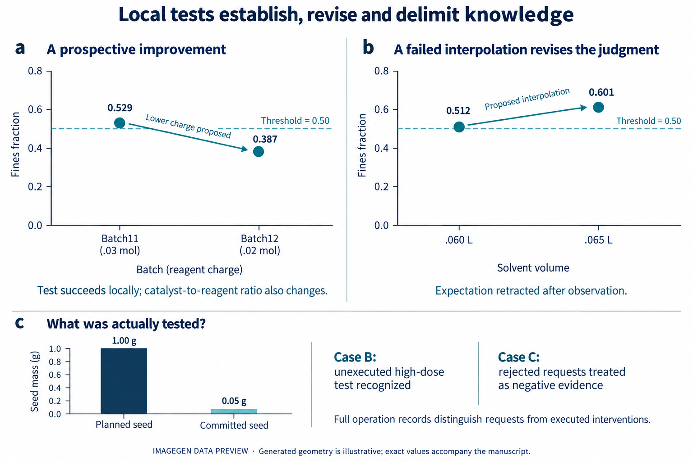

**自主科学的核心承诺，是使实验自主性转化为科学认识的拓展 [@tom2024selfdriving; @boiko2023autonomous]。我们利用 ChemWorld 的可编程化学世界，研究自主探索如何形成随后据以判断的科学关系。九十场重复过程研究连接实验选择、观测、同期判断与新条件预测；另行三十场比较在初始科学信息与评估协议匹配时，获得研究机会产生何种影响。研究使总体预测误差降低 73%，却使三道事先指定的极稀条件题误差增加 69%。同一比较中的连续记录显示，研究者修订初始预期、执行新的检验并建立有范围的局部关系，随后却在实验尚未解决的外推中赋予这一关系较大权重。修正协议后的结晶研究揭示已获证据使用的另一种分化：回收率预测在 39/42 场优于源观测均值，纯度则没有一场优于该参照。自主研究因此能够形成有效的局部认识，同时使某些超出已测范围的判断变差。它对科学认识的贡献，取决于实验结果如何被解释、所获关系的证据范围如何被保留，以及这些关系如何被用于新的条件。**

自主研究者不仅干预世界，也通过实验与测量的选择，塑造科学判断赖以形成的经历：哪些现象被看见，哪些解释受到检验，哪些结果成为下一次研究的依据。因此，自主科学的承诺既涉及实验能力的扩展，也涉及实验经历向科学认识的转化。

机器人科学家与自驱动实验室已经展示了假说检验、材料发现和反应优化能力 [@king2009automation; @burger2020mobile; @macleod2020selfdriving; @szymanski2023alab]。语言模型智能体进一步连接科学指令、工具与实验操作 [@bran2024augmenting; @dai2024mobile]。这些进展使一个更深的问题进入可研究的范围：智能体自己开展的研究，怎样改变它用来解释和预测世界的关系判断？有效方案构成实验成果，正确预测体现预测准确性；但两者都不能单独说明某项判断从何种证据中形成，以及这些证据支持多大的范围 [@elmachtoub2022spo; @shmueli2010explain]。

我们利用 ChemWorld 考察这一过程。可编程的世界规律和独立指定的公开信息，使我们能够研究初始知识怎样进入实验选择、观测怎样支持或改变判断，以及这些判断怎样指导后续研究。证据从研究的组织方式出发，追踪工作关系的形成，再考察它们如何被用于新干预。有依据的局部检验、合理修订、缺少执行支持的解释与响应不同的迁移表现，并不必然共享同一种失败机制；它们共同说明，研究的科学后果取决于证据选择、解释和使用之间的连续转变。

## 使自主科学探索成为可检验的研究对象

ChemWorld 将材料、操作与仪器组合为具有持续状态的虚拟化学系统。智能体在固定资源范围内，自主决定投料、处理顺序、测量、重复及后续实验。这些选择改变样品，也决定哪些观测能够进入研究。评估者独立控制世界参数和公开信息，记录实际提交的操作，并获得封存的参考结果（图 1）。智能体在研究与评估阶段均看不到这些参考真值。

这一安排使智能体的研究过程能够被具体考察。知识测试和给定数据任务评价重要的科学能力 [@mirza2025chembench; @majumder2025discoverybench]，交互式发现环境也已连接行动与观测 [@wang2022scienceworld; @jansen2024discoveryworld; @gandhi2025boxinggym; @chen2025physgym]。ChemWorld 进一步在可组合的化学过程中，连接智能体自主选择的证据、不断变化的公开判断及其后续用途。一次操作请求可能在改变样品之前被拒绝；一项观测也可能只支持局部关系，尚未确定其在其他干预下是否成立。执行记录和独立评估的世界响应使这些区别能够被核对。

广度研究包含 Sol 在六类化学体系中的 240 场研究，以及另外四种模型配置的 60 场平衡研究。当前过程分析采用 45 场平衡研究和修正回收定义后重新执行的 45 场结晶研究。每个体系覆盖五个固定世界、三种信息条件、每格三次独立启动的模型会话。90 场中有 80 条完整研究—评估链、83 份有效预测；不完整会话仍保留在计划分母中。早期受回收描述不一致影响的结晶会话单独保留，不与修正版合并。

同期笔记将公开判断定位到当时可用的观测。研究结束后，智能体先封存科学解释，再在无法访问实验工具的条件下预测十二个新干预，最后在未获知真值的情况下反思。结构化过程分析在当前 90 场中的 65 场识别出 92 个可观察的“判断—实验—修订”窗口（扩展数据图 1）。其余 25 场在这一记录定义下缺少完整窗口，不能据此认定没有科学学习。另一个同期比较让 30 场新会话在共同评估协议下分别获得或不获得研究机会（图 4）。这些证据层回答互补问题，分别保留各自分母。

## 科学探索的自主组织与适应

探索始于研究目标、可用信息和受约束的行动空间。对 150 场保留研究的描述性比较显示，这些起点怎样进入证据经历。修正版结晶中，Aligned 条件的十五场均从溶剂 S2、催化剂 C1 开始；没有实例资料的十五场均从 S0、C0 开始。指定错配资料下，十三场从 S2 开始，十四场首先使用 C1。这些选择定位研究的起点，本身尚不构成学习的证明。

后续溶剂覆盖有所不同，但探索广度不足以完整说明科学探索。历史电化学发现与优化任务的溶剂覆盖接近，较大预算下均覆盖全部四种溶剂；完整路径统计和初始选择计数保留在补充材料。更有解释力的问题是：一次观测怎样改变研究者下一步要检验什么。

新增研究机会比较中的一条连续轨迹，下文统一称为“平衡研究 A”，使这一转变具体可见（图 2）。该研究采用 Opaque 信息，没有获得实例专属的档案关系。初始笔记预期弱酸趋势：浓度升高应降低 pH 和解离分数，但前六次实验的解离分数始终约为 0.064–0.079。下一版笔记撤回原趋势在已测范围内的支持，并提出另一可操作组分可能才是相关输入。第八至十二批实际改用该组分，响应依然接近平台。封存解释保留局部关系，同时没有认定唯一隐藏机制。这连接了事前预期、相反观测、新候选解释和真正执行的检验。

其他研究也会继续最初已经计划的扫描、缩小参数区间或重复临界配方。这些都属于研究组织，但其中只有一部分是在反馈之后新提出的检验。修正版结晶的 58 个窗口中，52 个所选即时计划与实际动作匹配，6 个部分匹配。这刻画了可观察窗口中的公开计划—行动联系，既不是发现率，也不能证明写下笔记导致了行动。接下来需要考察的是，这些行动与观测究竟建立了什么。

![图 2 | 平衡研究 A：从修订预期到外推。同一研究会话及其匹配无研究预测的 ImageGen 数据预览。a，前六次测定不支持初始弱酸趋势在当前范围内的适用性。b，新候选解释进入第 8–12 批替代组分检验，响应仍接近平台。c，封存解释中的局部关系随后在极稀预测中获得较大权重，引文为原文。d，研究组预测解离分数 0.085 [0.035, 0.350]，无研究组 0.569 [0.040, 0.980]，封存参考均值为 0.716。区间为研究者给出的 80% 预测区间，源点为单次测定。这是新增研究机会比较的案例，证据包保留完整身份；生成几何为示意。](figures/preview-20261015/figure02.png)

## 科学认识在实验中的形成与演变

科学关系在支持进一步检验、约束解释或指导新干预时，获得实际研究意义（图 3）。一场修正版结晶研究在获得接近细粉阈值的结果后，事前提出将试剂投料从 0.03 降至 0.02 mol。下一批执行了该提议，并通过细粉要求。这支持一项局部配方改进。然而，催化剂绝对量保持不变，其相对试剂的比例也随之改变，因此实验并未单独识别浓度机理。

另一场结晶研究检验了插值判断：根据邻近溶剂体积下不同的回收与细粉表现，研究者提出 0.065 L 应保留回收收益并改善细粉。下一批的细粉却从 0.512 升至 0.601，末版笔记随后撤回预期。一次未成功的操作干预，由此产生明确响应证据的认识修订。结合前述低投料成功检验，实验可以通过两种方式推进工作判断：建立局部改进，或撤回观测未能支持的预测。

干预是否真正发生，也决定能够从中学到什么。播种案例 B 计划累计加入约 1 g 晶种，实际只有 0.05 g 提交，随后十九次请求被拒；后续笔记正确识别高剂量检验尚未执行。播种案例 C 遇到类似拒绝，却把 1 g 描述为已测条件，并用结果反对播种解释。对照揭示同类执行限制怎样被赋予不同证据意义。其他热历史解释及临界条件重复案例保留在补充记录中。

同一项平衡研究 A 随后将有依据的局部修订带入了新条件判断（图 2c,d）。面对极稀条件，研究者写道：“The point estimate still favors the experimentally supported fixed acidic background”，预测解离分数为 0.085、80% 区间为 0.035–0.350，封存参考均值则为 0.716。解释与预测都承认这一条件未经检验，因此问题比遗漏一句范围声明更具体：得到局部支持的关系，在实验尚未解决的外推中获得了较大权重。同题匹配的无研究会话预测为 0.569、区间为 0.040–0.980，并明确依赖未经检验的先验假设。其数值更准确，并不等于形成了更好的实验发现。

这种延续并不必然发生。另一固定平衡世界中的两场研究都只在较高投料区间观察到平台，极稀宏平均误差却分别为 0.16287 和 0.01462。同一道极稀问题中，它们预测解离分数为 0.130 和 0.626，参考均值为 0.65463。更准确的一场采用了与平台观测相容的弱酸延续，同时明确称其为推测。准确外推不要求直接采样每个目标条件；准确本身也不等于研究已经通过实验识别了正确解释。连续记录使局部支持、未决可能及其后续预测用途能够被分别考察。

## 自主探索中科学进展的性质与条件

过程记录定位判断怎样形成和被使用，匹配的研究机会比较则检验获得研究机会是否改变后续预测（图 4）。三十场均采用 Opaque 信息：提供公开任务、材料标识、测量尺度、合法操作与初态，没有提供实例专属档案定律或拟合关系。五个平衡世界各配置三场拥有十二批源实验机会的新会话，以及三场没有源实验的新会话；同世界同重复的两组科学输入与封存评估相匹配。三十场全部终态，180 批计划源实验全部完成，二十九场提供有效预测。一场因网络中断缺失预测及随后阶段，其源观测和科学解释仍予保留。

研究总体上大幅降低了平均误差。先在世界内平均有效会话、再对五个世界等权，归一化宏平均绝对误差由无研究的 0.132086 降至有研究的 0.035632，下降 73.0%，五个世界方向一致。但在事前指定的三道极稀问题上，误差从 0.061467 增至 0.103677，增加 68.7%，五个世界中四个恶化。其余九题的误差则从 0.155625 降至 0.012950。这一比较考察整个研究机会组合，包括实验选择、反馈与可用记录工具，不单独归因于其中某个组成部分。

同一研究机会因此可以改善总体预测，同时损害特定区域的预测。极稀子集中，三个响应的平均点预测误差均增加，幅度不同：研究减无研究的 MAE 差值，归一化 pH 为 +0.00777、解离分数为 +0.10795、沉淀信号为 +0.01092；解离分数贡献了宏平均误差增量的 85.2%。这是总体拆分，不意味着每道题、每个世界或每次会话均恶化。图 4 展示会话点和世界均值，完整逐会话逐响应及逐题结果随稿提供。平衡研究 A 则给出一条从有效局部发现走向远端判断的可观察路径，不能据此认定它解释所有会话差异。

这一结果还涉及区间判断，却不支持统一的“更自信但更错误”叙事。在极稀条件下，有研究组三个名义 80% 区间的实际覆盖率均低于无研究组，但无研究组区间明显更宽。兼顾宽度与漏覆盖惩罚的区间分数，在 pH 上支持有研究组，在解离分数上支持无研究组，在沉淀信号上接近；全部问题合计，研究改善三个响应的区间分数。让唯一缺失会话的宏平均误差取遍合法范围的保守敏感性分析，也不能翻转总体收益或极稀损失这两个平均方向（方法）。

结晶揭示已获证据使用的互补现象（扩展数据图 2）。对 42 份有效预测，我们构建只利用该会话源观测的透明参照。五世界等权纯度误差，智能体为 0.03853，全部源观测均值为 0.00510，且每个有效会话中后者都更准确。回收率方向相反：智能体误差为 0.10129，参照为 0.20443，39/42 场优于均值。按精确已提交溶剂集合限定参照后，两个总体方向仍保留；粒度、细粉分别有 5/42、23/42 场胜出。该比较诊断已有证据在不同响应中怎样被使用，源均值既不是无研究组，也不是另一名自主研究者，因而不直接估计结晶研究的因果收益。

这些发现补充了早期的操作—预测比较。电化学优化在三十个匹配条件中的二十六个获得更好的推荐方案，其中预测更好与更差各十三个。重复平衡队列中，正确但不完整的先验使九题误差从 0.00907 降至 0.00512，却使极稀误差从 0.09880 增至 0.13205。初始信息、实验成就与后续预测都参与构成科学结果，但都不能替代对“研究支持了何种关系，以及它被怎样使用”的考察。

## 讨论

自主研究能够形成有效的局部认识，却不保证这些认识在后续应用中保持与证据相称的范围。匹配比较中，研究大幅改善总体预测，同时使事先指定的极稀区域预测变差。连续轨迹表明，这种分化可以与合理修订和新的实验并存：研究者撤回初始预期、检验竞争可能并建立有范围的经验关系，随后却在尚未解决的条件中赋予这一关系较大权重。结晶参照揭示互补局限：同一研究历史支持某些响应的有效预测，却未能充分保留另一些已经观察到的关系。这些结果具体说明了研究贡献什么，以及研究成果如何被使用。

研究科学认识的形成，需要具体说明提出了什么关系、当时什么信息支持它、世界实际检验了什么，以及关系随后怎样被使用。记录既包含合理撤回和范围明确的改进，也包含缺少实际执行支持的解释；还包含依赖未被实验确定的可能性所作出的准确预测。这些区别与科学研究中区分性检验和推断的作用相一致 [@platt1964inference; @lindley1956information; @chaloner1995design]，但不能从成功调用工具或连贯的科学解释中，直接假定自主智能体已经实现了它们。

对照实验限定了可以作出的因果解释。匹配的研究机会比较，在共同评估协议下估计整段研究机会的作用。另一个固定配方淬灭对照识别操作在虚拟世界中的物理效果，其结果没有交给能够适应的研究者（扩展数据图 3）。两者均未单独识别笔记的作用，也不能证明某项判断通过选择性实验维持自身。解释已经观察到的关系形成与使用，不要求每条轨迹共享这类机制，也不要求最终以一种纠错策略成功收束。

本研究局限于选定的可编程体系、少量固定世界，以及重复过程分析中的一种模型配置。新会话既不是受控模型 seed 重复，也不是世界规律的独立样本。笔记是公开记录，不是内部认知读数；记录间隔限制时间推断。案例从系统保留的记录中事后选取，由单一分析者解释，没有第二评分者的一致性估计。历史与当前协议分别保留来源，包括修正版结晶及全部失败。这些边界限制发生率和普遍性主张，同时保留可核对的过程转变与限定明确的比较。

自主研究的价值因此不仅取决于有效实验结果的积累，还取决于这些结果建立了什么关系，以及研究者如何将关系的证据范围带入后续探索。本研究既显示大幅的总体收益，也显示这一收益在明确预测区域中的方向逆转；连续记录进一步连接了预期、局部发现和后续判断的具体转变。自主探索中的科学进展，发生在证据被持续解释和使用的过程中。ChemWorld 使这些转变能够接受实验比较与核验。
