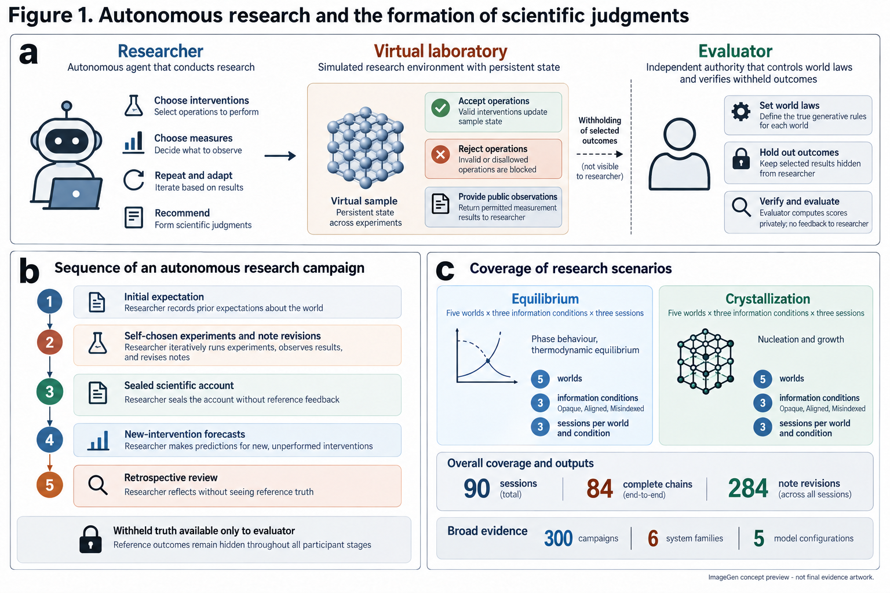
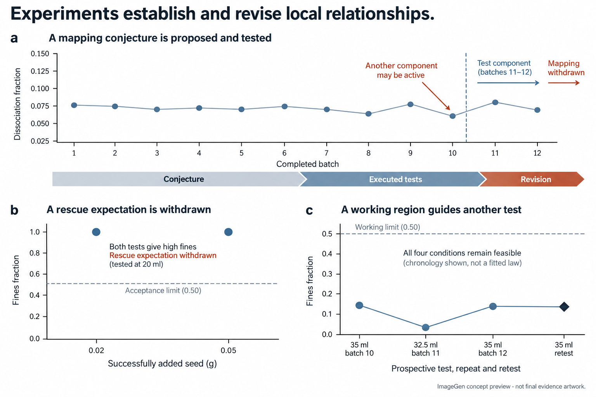
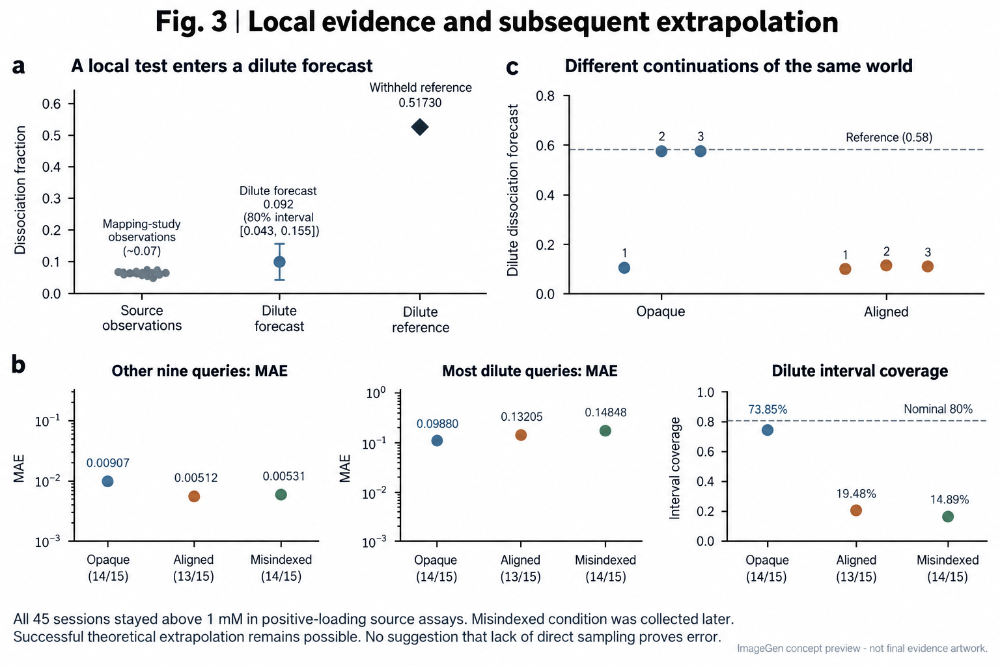
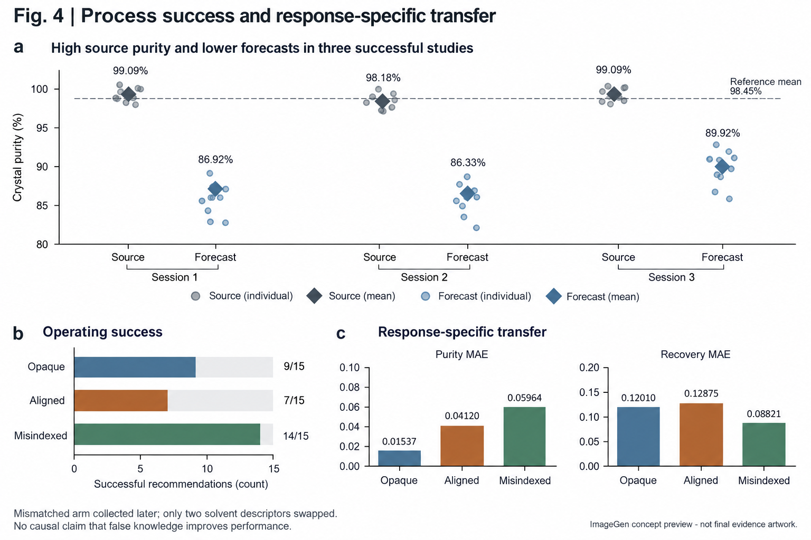

**自主实验室扩大了机器选择和执行实验的能力 [@tom2024selfdriving; @boiko2023autonomous]。其科学价值还取决于：自主选择的实验经历如何成为后续判断的依据。我们利用可编程化学世界，连接智能体的自主实验选择、同期科学记录与新干预下的预测。跨体系研究表明，操作成功与预测准确性可以分离。随后开展的平衡与结晶重复研究揭示，智能体能够提出区分性检验、修订预期，并建立有适用范围的工作关系。这些成果可以与随后使用证据时的偏离并存：削弱某种解释的局部检验，可能被用于支持实验尚未区分的外推；成功的工艺与明确的高纯度认识，可以与显著偏低的纯度预测同时出现。在另一些案例中，被拒绝的操作进入后续报告，成为已经完成的阴性检验。我们将这些过程与范围适当的结论、以及未经直接采样的成功外推加以区分。研究由此将科学判断放回产生其证据的自主科研过程：实验自主性能够支持有效关系的形成，而这些关系的证据范围与后续用途，需要分别考察。**

科学研究改变了研究者能够对一个系统作出何种有依据的判断。实验揭示结果，但选择解释、界定适用范围并据此指导下一次干预，仍需要进一步判断。随着机器获得更大的实验自主性，这些判断越来越多地建立在它自己选择获取的证据之上。由此形成的研究经历决定了哪些可能性已经接受检验，哪些仍然未决。

机器人科学家和自主实验室已经展示了假说检验、材料发现与反应优化能力 [@king2009automation; @burger2020mobile; @macleod2020selfdriving; @szymanski2023alab]。语言模型智能体进一步连接科学指令、工具与实验操作 [@bran2024augmenting; @dai2024mobile]。然而，有效的操作方案本身不能确定研究者学到了什么，准确预测也不能唯一确定其推断和证据依据 [@elmachtoub2022spo; @shmueli2010explain]。理解自主科研，需要沿着判断在研究中获得支持并被实际采用的过程展开。

ChemWorld 为这一研究提供了条件。智能体围绕持续演化的虚拟样品组织实验，评价者则独立控制兼容的过程规律和公开信息。我们把操作与预测的广泛比较，连接到带同期记录本的重复研究。这些记录展示了有价值的修订、尚未解决的竞争解释，以及实际检验内容与随后被当作已建立关系之间的具体差异。核心问题是：实验经历如何成为科学关系，以及当这项关系被用于超出原有证据的判断时，会发生什么。

## 自主研究成为可以核对的实验过程

ChemWorld 将材料、操作与仪器组合成具有持续状态的可编程化学体系。研究者自主选择用量、操作顺序、测量、重复与后续实验；操作可能不可逆地改变样品、消耗资源，也可能在改变物理状态之前被拒绝。评价者保留实际执行的状态转移及其底层响应。这些是受控的虚拟化学世界，不代表对物理实验室中特定真实物质的预测已经获得验证。

这一安排扩展了知识测验和给定数据型发现任务能够提供的证据 [@mirza2025chembench; @majumder2025discoverybench]。既有交互式发现环境也已经连接了行动与观测 [@wang2022scienceworld; @jansen2024discoveryworld; @gandhi2025boxinggym; @chen2025physgym]。在这里，可组合的化学操作使同一研究者的取证选择、逐步形成的公开解释和关系使用能够被共同考察（图 1）。

保留的广度研究包括六类体系的 240 场研究，以及其他四种模型配置的 60 场平衡研究，提供操作与预测比较的背景。在电化学 30 个匹配比较中，优化任务有 26 次给出更高分的推荐，但其中预测更好与更差各有 13 次。研究资源和先验信息也在部分条件下表现出正向作用：增加分配体系的实验预算，使有机相份额预测误差从 0.08291 降至 0.02379；相符的反应先验在两种研究目标下均改善五个世界中的四个。这些是独立研究之间的比较，并非同一研究者的纵向学习曲线。

为考察实验期间的判断形成，另一队列覆盖平衡与结晶，每种体系包含五个世界、三种信息条件、每条件三次全新会话。智能体分别获得不附加实例信息、相符的部分先验或指定的错配先验。全部使用相同的 Sol-medium 配置和十二批研究预算。90 场均到达终态，其中 84 条研究与后测链完整，保留 284 版笔记。失败保留在计划分母中。实验结束后，智能体封存科学报告，在无法继续操作实验室的条件下预测固定的新干预，随后在不见预测真值的情况下反思。重复固定世界参数和观测映射，但未控制模型采样随机性。

## 实验能够建立和修订局部关系

记录本展示了研究者提出可检验预期，并在看到结果之后修订它。在一项错配先验的平衡研究中，近乎平坦的试剂装料响应引出了另一种解释：另一个可访问组分可能才是有效的活性坐标。在最后两批实验之前，智能体预测，若该解释成立，这个组分应带来显著响应。它随后测量仅含该组分的样品，以及在少量试剂上大幅加标该组分的样品。两者仍接近原平台。随后的笔记撤回了对所测映射的支持，同时保留多个平台解释（图 2a）。这是公开猜想得到实际检验的过程，但没有唯一识别隐藏机制。

结晶研究提供了更直接的前瞻检验。高浓度配方未达到细粉要求后，研究者提出增加种量以改善颗粒质量。相关两批保持主要准备与冷却操作相同，成功加入的种量分别为 0.02 和 0.05 g。两批细粉份额均为 1.0。下一版笔记明确撤回该条件下的拯救预期（图 2b）。智能体最终推荐另一条独立复测合格的工艺。另一项研究在降低装料反而加重细粉后，撤回了预期的单调装料效应。因此，即使改善操作的提议失败，科学判断的修订仍可观察。

实验关系也能够成为继续研究的工作依据。在另一项结晶会话中，成功和失败工艺促成了体积窗口探索。研究者在 35 ml 获得可行工艺后，明确提出下一批检验 32.5 ml。新检验保留其他主要操作且仍然合格，随后重复 35 ml，最终推荐另经独立复测（图 2c）。该序列建立了可用配方，并支持一项后续检验。更早的低体积失败同时改变了种量或热历史，因此不能据此独立识别浓度阈值。

记录中也包含适当的范围限定。研究者会区分观测到的配方趋势与单独识别的温度系数、有证据支持的区域与普遍溶剂排序，以及未决的小差异与可重复改善。这些限定本身就是正在形成的科学判断。它们也提供了进一步的问题：当研究者随后作出另一类决策时，同样的限定是否仍然发挥作用。

## 局部证据进入不同的外推判断

上述平衡映射研究还显示，有效的局部修订可以伴随后续缺乏充分支持的扩展。最终报告仍将缓冲、饱和与未识别耦合列为竞争解释。然而，面对极稀查询时，智能体明确援引“仅加入另一组分仍近平台”的结果，将预测强烈收缩到实验基线。解离率预测为 0.092，80% 区间为 0.043–0.155，参考均值为 0.51730（图 3a）。局部组分检验削弱了某种活性坐标解释，却没有确定平台是否延续到极稀条件。事后反思中，智能体承认区间没有充分表示这些未决可能。

这比没有注意到不确定性更具体。科学报告承认不确定性，数值预测却给某一种关系延续赋予了更大的实际权重。公开理由连接了早先观测与这次选择，但没有证明写下笔记的因果作用，也不直接揭示内部推理。

重复队列将该案例放入更广的结果分布。相符先验使其余九题的五世界平均误差从 0.00907 降至 0.00512，却使极稀三题误差从 0.09880 增至 0.13205（图 3b）。局部改善在五个世界均出现，极稀区恶化在四个世界出现。极稀区名义 80% 区间的实际覆盖从 73.85% 降至 19.48%。错配先验对应误差为 0.00531 和 0.14848，极稀覆盖为 14.89%。错配臂全部在后一期执行，不能视为与先前信息臂同期随机化的比较。原研究约 8.7 倍的收益反转幅度没有在本轮稳定重复；本轮相符相对不附加先验的比值约为 1.34。

全部 45 场平衡研究的正装料源期测量均未进入 1 mM 及以下区域。尽管如此，相近的平台观测仍可支持不同的预测构造。在同一世界的重复中，不附加先验会话既出现近平台预测，也出现较大且准确的解离率预测；相符先验会话则持续更接近平台（图 3c）。另一场不附加先验会话在回答预测题时引入有效可溶浓度上限，给出较准确的稀释预测，随后承认该机制在先前报告中只是候选之一。

因此，直接采样不是合理或成功外推的必要条件。在独立的五模型研究中，Sol/Opaque 未进入稀释区却准确外推；另一场 Astra 研究则先在低浓度自主观测到显著上升，再准确预测新的稀释条件。这些路径区分了预测准确、研究期获得证据，以及通过实验区分解释。单一终点分数会压缩这些差别。

## 可用工艺能够与不可靠的迁移同时存在

结晶揭示了互补问题：研究者可以正确识别稳定响应，却在预测新条件时大幅修改它。在同一世界和错配信息下的三次会话中，每个智能体均找到了复测合格的配方，也均在科学报告中识别出高纯度。源期平均纯度分别为 99.09%、98.18%、99.09%，对新配方的平均预测却为 86.92%、86.33%、89.92%；共同参考均值为 98.45%（图 4a）。

第一次会话尤其清楚地展示了同一研究中的分化。源期报告描述了显著杂质排除和有范围的可行工艺区域。进入预测后，智能体分别对溶剂、杂质包埋、浓度和热历史作出调整。回收率 MAE 为 0.04371，纯度 MAE 却为 0.11529，十二个纯度区间无一覆盖参考。新配方确实要求判断条件变化；这并不意味着直接重复源期均值总是正确。但在这里，尽管公开报告准确描述了源期高纯度，后续调整仍明显偏离当前世界。

全部 45 场结晶会话中，Opaque、Aligned、MisIndexed 同时满足质量和回收目标的推荐分别为 9/15、7/15、14/15；五世界平均纯度 MAE 分别为 0.01537、0.04120、0.05964（图 4b,c）。错配臂的较高操作成功率不能解释为错误知识的收益：它仅交换两个溶剂描述，保留了频繁使用的 S2 描述，且在后一期执行。同一臂较低的回收误差与较高的纯度误差，说明各响应对应的判断仍需分别呈现。指定热条件对比的细粉方向预测正确次数分别为 7/15、9/15、6/15。

这些结果延伸了较早的结晶发现：尽管源期与参考纯度均接近 98.5%，360 个纯度预测中仍有 335 个偏低。同期记录现在进一步显示，同一研究者可以同时拥有有效工艺知识、明确的高纯度描述和不准确的迁移判断。这些证据没有确定遗忘、上下文丢失或某种共同机制是原因。

## 判断的证据地位本身也可能偏离执行记录

某些偏离发生在迁移之前。一名智能体将剂量上限理解为每次操作而非每批上限，提出检验约 2 g 累积种量。它请求四十次 0.05 g 加入，但只有第一次成功，其余三十九次均被拒绝。后续笔记仍声称，种量从 0.05 增至约 2 g 没有降低细粉，据此排除种量作为限制因素。最终报告和事后反思保留了这一结论（扩展数据图 1）。

所声称的剂量比较并未完成，因而不能提供大剂量无效的阴性证据。该轨迹定位了预期检验成为看似已建立排除结论的过程。另一个智能体则正确记录追加被拒绝，并据此限制后续剂量。执行失败并不必然成为科学记述错误。前一个案例涉及执行状态解释，不能单独解释其他概括错误，也没有证明错误笔记对随后行动的因果作用。

同样，认识到不确定性并不自动决定操作选择。一名研究者表示偏好细粉余量，最终却选择观测中最高回收的边界可行配方，无噪复测失败；另一名研究者放弃部分观测回收以保留余量，复测通过（扩展数据图 2）。任务奖励观测合格条件下的回收，因此边界选择并非自动不合理，但它与研究者公开表达的决策原则之间的关系仍有意义。

## 将科学判断作为研究过程的结果

这些发现赋予自主科研的核心承诺以具体内容：实验自由能够支持科学理解的发展。智能体提出检验、修订预期并建立有范围的工作关系。沿着同一关系进入后续报告与预测，又能看到不同偏离：尚未区分的延续方式获得数值权重，已识别的稳定响应未被充分保留，或者未执行的检验成为排除理由。这些结果可以发生在同一段研究经历中。

共同研究对象是证据与其使用之间的关系，而非唯一失败机制。实验设计和强推断提供选择信息性检验的原则 [@lindley1956information; @chaloner1995design; @platt1964inference]，本研究还涉及已完成检验如何被表述，以及不确定性如何进入后续判断 [@gneiting2007scoring; @ovadia2019uncertainty]。匹配淬灭对照独立核实了某项操作在保留虚拟配方中的整体效果（扩展数据图 3），但没有确定智能体为何采用某种解释。对这些转变作因果解释，需要针对性比较，不能预设所有错误都通过选择性采样维持自身。

过程队列只有一种模型配置，使用重复固定世界和带记录本的工作流程。案例由单一分析者事后解释，公开表述并非内部信念的直接测量。较早的跨模型证据涉及研究路径与终点，而非已完成的跨模型同期认识形成分析。这些限制界定了本研究的结论：自主研究能够产生有实验支持的局部知识，但一项关系被声称具有的证据、其表述的适用范围与新判断中的实际用途，仍然可以分离。使这些转变可被观察，为理解实验自主性如何成为科学认识提供了基础。
