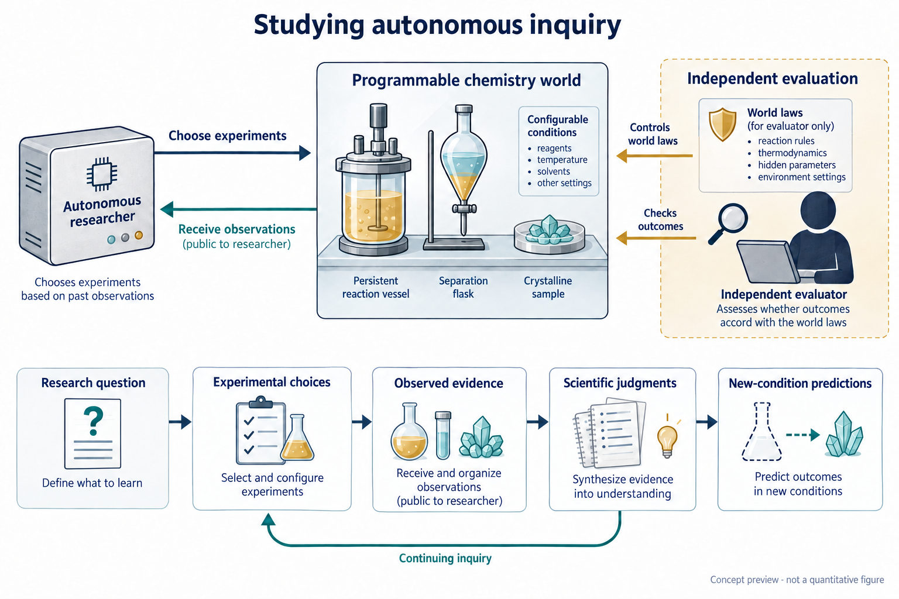

**自主科学的核心承诺，是使实验自主性转化为科学认识的拓展。然而，智能体如何组织探索，并将实验经历转化为知识，仍缺少充分理解。我们提出 ChemWorld，以可编程化学世界结合自主实验和对科学规律、信息供给的独立控制。通过跨化学体系、模型配置与重复研究，我们连接研究目标、先验知识、实验选择、不断变化的判断及新干预下的预测。智能体能够检验预期、修订解释并建立有效的局部关系；这些成果可以沿不同研究路径形成，相近的预测准确性也可能建立在不同证据经历之上。然而，实验进展并不总能转化为可靠的概括：局部关系可能在其已确立范围之外获得较大权重，已观察到的规律也可能未被后续判断充分保留。通过追踪这些转变，并在初始信息匹配时比较是否获得研究机会，我们考察探索对科学认识的贡献。ChemWorld 使自主研究本身成为可实证考察的对象，连接科学探索的组织与知识的形成、修订和使用。**

自主研究者不仅干预世界，也通过实验与测量的选择，塑造科学判断赖以形成的经历：哪些现象被看见，哪些解释受到检验，哪些结果成为下一次研究的依据。随着 AI 科学家与自驱动实验室连接日益复杂的实验循环，探索的组织本身也成为委托给机器的科学活动 [@tom2024selfdriving; @boiko2023autonomous]。因此，自主科学的承诺既涉及实验能力的扩展，也涉及实验经历向科学认识的转化。

机器人科学家与自驱动实验室已经展示了假说检验、材料发现和反应优化能力 [@king2009automation; @burger2020mobile; @macleod2020selfdriving; @szymanski2023alab]。语言模型智能体进一步连接科学指令、工具与实验操作 [@bran2024augmenting; @dai2024mobile]。这些进展使一个更深的问题进入可研究的范围：智能体自己开展的研究，怎样改变它用来解释和预测世界的关系判断？有效方案构成实验成果，正确预测体现预测准确性；但两者都不能单独说明某项判断从何种证据中形成，以及这些证据支持多大的范围 [@elmachtoub2022spo; @shmueli2010explain]。

困难在于，自主研究者能够获得的证据，本身就是其研究的结果。初始解释可以提出值得执行的实验；观测可以支持、缩小或取代这一解释；形成的判断又可以指导下一次干预。一连串成功实验可能建立有效的局部关系，却未解决它在已观察条件之外是否成立。相反，失败的干预也可以通过排除某项预期而推动认识。考察这种交互，需要连接研究者最初有何理由作出预期、实验实际检验了什么，以及后来把什么当作已经确立的关系 [@platt1964inference; @lindley1956information; @chaloner1995design]。

我们利用 ChemWorld 考察这些联系。可编程的世界规律和独立指定的公开信息，使自主实验经历能够相互比较，其科学后果也能够独立评价。跨体系研究建立操作与预测结果的广度；五模型比较识别获得证据和进行外推的不同路径；带同期记录的重复研究定位判断的变化；匹配的研究机会比较则检验开展研究的贡献。这些研究共同追踪探索的组织、关系的形成及其在新干预中的使用，同时考察有效的科学活动与偏离证据的判断，不要求它们共享单一机制。

## 使自主科学探索成为可检验的研究对象

ChemWorld 将材料、操作与仪器组合为遵循热力学、动力学和耦合过程关系、具有持续状态的虚拟化学系统。反应、热处理、相平衡、分离和结晶组件可以连接为多阶段流程。样品状态持续保留，上游反应或热历史因而能够改变后续分离与测量。智能体在固定资源范围内，自主决定投料、处理顺序、测量、重复及后续实验。这些选择既决定所开发的方案，也决定据以推断的观测。评估者独立控制世界参数和公开信息，记录实际提交的操作，并获得封存的参考结果（图 1）。智能体在研究与评估阶段均看不到这些参考真值。

这一安排使智能体的研究过程能够被具体考察。知识测试和给定数据任务评价重要的科学能力 [@mirza2025chembench; @majumder2025discoverybench]，交互式发现环境也已连接行动与观测 [@wang2022scienceworld; @jansen2024discoveryworld; @gandhi2025boxinggym; @chen2025physgym]。ChemWorld 进一步在可组合的化学过程中，连接智能体自主选择的证据、不断变化的公开判断及其后续用途。一次操作请求可能在改变样品之前被拒绝；一项观测也可能只支持局部关系，尚未确定其在其他干预下是否成立。执行记录和独立评估的世界响应使这些区别能够被核对。

广度研究包含 Sol 在电化学、分配、反应处理、水溶液平衡、反应耦合结晶和纯化六类体系中的 240 场研究，以及另外四种模型配置的 60 场平衡研究。这些体系支持不同科学问题，包括开发有效的电学或热处理方案、刻画浓度响应，以及在质量约束下回收物料。发现与优化目标、部分先验信息和实验预算，在相应实验块内提供互补比较。每个实验块采用五个固定世界和三种信息条件：Opaque 保留操作契约但不提供额外实例资料；Aligned 提供正确但不完整的信息；MisIndexed 提供指定错配。这些设置改变研究起点，同时保留对应的实验接口。

当前过程分析通过 45 场平衡研究和统一回收定义后的 45 场结晶研究，提高对认识变化的时间分辨率。每个体系覆盖五个固定世界、三种信息条件、每格三次新模型会话。90 场中有 80 条完整研究—评估链、83 份有效预测；不完整会话保留在计划分母中。早期受回收描述不一致影响的结晶会话单独保留。广度研究建立跨体系差异，重复研究则考察具体判断怎样形成，以及如何随研究经历而变化；其协议和分母不合并。

同期笔记将公开判断定位到当时可用的观测。研究结束后，智能体先封存科学解释，再在无法访问实验工具的条件下预测十二个新干预，最后在未获知真值的情况下反思。结构化过程分析在当前 90 场中的 65 场识别出 92 个可观察的“判断—实验—修订”窗口（扩展数据图 1）。其余 25 场在这一记录定义下缺少完整窗口，不能据此认定没有科学学习。另一个同期比较让 30 场新会话在共同评估协议下分别获得或不获得研究机会。贯穿这些证据层，我们分别考察关系与世界结果是否一致、当时有何证据支持，以及研究者后来怎样使用它。

## 科学探索的自主组织与适应

探索始于研究目标、可用信息和受约束的行动空间。历史电化学与反应研究分别要求智能体发展并检验科学理解，或优化公开的操作评分。这些任务产生了实际实验成果，但操作和预测的收益并不可以互相替代（图 2a）。30 组匹配的电化学比较中，优化任务在 26 组取得更好的独立复测方案；其中十三组的预测误差更低，另十三组更高。反应处理中，发现任务在三十组中的十七组同时取得更好方案和更准确的评分预测。研究目标与科学后果之间的关系，因而需要结合探索实际建立了什么来理解。

一组电化学研究使这一区别具体可见（图 2b）。发现任务先比较材料与条件，再增加时长和电流上限；优化任务先筛选材料组合，再围绕有希望的组合调整操作条件。优化推荐的复测评分为 0.756，高于发现任务的 0.718，但预测平均绝对误差（MAE）为 0.229，高于 0.088。优化研究者在后续预测理由中，将若干表现不佳的交叉材料组合概括为低活性。对于其中一个组合的新条件，它预测 0.070，而参考为 0.494；另一个预测仍准确，为 0.570 对 0.572。这些经历揭示了单一终点评分无法说明的差别：成功开发实验方案，可以与对更广实验空间的不均衡判断并存。

先验信息提供了进入研究组织过程的另一切入口。修正版结晶中，Aligned 条件的十五场均从溶剂 S2、催化剂 C1 开始；没有实例资料的十五场均从 S0、C0 开始。指定错配资料下，十三场从 S2 开始，十四场首先使用 C1。Aligned、Opaque、MisIndexed 的平均实际使用溶剂数分别为 2.93、4.00、2.40。这些描述性差异显示给定信息如何进入材料选择；覆盖更广本身并不证明学习更好。反应处理中，部分参数知识具有明确的预测收益：Aligned 将发现目标的宏平均 MAE 从 0.102 降至 0.057，将优化目标的误差从 0.139 降至 0.084，在两类目标下均于五世界中的四个优于 Opaque（图 2c）。

相同目标与科学条件下，研究路径也会不同。五模型平衡比较允许研究者选择投料、稀释和加料顺序，再预测 pH、解离分数与沉淀。隐藏规律在较高浓度区间产生接近恒定的解离分数，在极稀条件下产生变化。Astra 的十五场研究中，十一场测量了名义浓度不高于 1 mM 的正投料样品；Sol、GPT-5.5、Luna、Terra 各十五场中均没有这样的测量（图 3a）。这一差异描述这些具体研究获得了什么证据，不定义模型固定的探索性格。

一场 Astra 研究展示了新证据的科学用途（图 3c）。前三次测定的解离分数为 6.3–7.4%；第五批测量 18.5 微摩尔每升条件，观察到 53.8%。后续科学解释区分高浓度平台与低浓度响应，并对 13.3 微摩尔每升条件封存预测 58.80%，80% 区间为 54.20–63.40%，参考均值为 57.97%。Sol/Opaque 则沿另一条路径获得准确预测：源研究始终未进入极稀区间，其五世界极稀宏平均 MAE 仍为 0.01833（图 3d）。因此，准确预测既可以伴随新响应的直接观测，也可以来自局部观测之外的外推。直接采样每个目标条件并不是成功推断的必要条件。

这些跨体系与模型比较建立了判断之前不同证据经历的存在。同期记录进一步让我们追问，反馈怎样进入下一次研究选择。一些研究继续最初计划的扫描；另一些重复临界配方、缩小参数区间或提出新检验。探索材料数量无法区分这些活动。例如，历史电化学发现与优化任务的溶剂覆盖接近，在较大预算下均覆盖全部四种溶剂，操作和预测结果却存在上述差异。

新增研究机会比较中的一条连续轨迹，下文称为“平衡研究 A”，使这一转变具体可见（图 4）。该研究采用 Opaque 信息，没有获得实例专属的档案关系。初始笔记预期弱酸趋势：浓度升高应降低 pH 和解离分数，但前六次实验的解离分数始终约为 0.064–0.079。下一版笔记撤回原趋势在已测范围内的支持，并提出另一可操作组分可能才是相关输入。第八至十二批实际改用该组分，响应依然接近平台。封存解释保留局部关系，同时没有认定唯一隐藏机制。这连接了同一研究经历中的事前预期、相反观测、新候选解释和真正执行的检验。

修正版结晶的 58 个窗口中，52 个所选即时计划与后续实际动作匹配，6 个部分匹配。这刻画可观察窗口中的公开计划—行动联系，不是发现率或写下笔记的作用。结合连续平衡案例，这些记录使探索的适应能够被观察：实验经历可以进入修订后的预期和后续行动。这些行动究竟建立了什么，则需要考察所形成关系的内容与范围。

![图 4 | 平衡研究 A：从修订预期到外推。同一研究会话及其匹配无研究预测的 ImageGen 数据预览。a，前六次测定不支持初始弱酸趋势在当前范围内的适用性。b，新候选解释进入第 8–12 批替代组分检验，响应仍接近平台。c，封存解释中的局部关系随后在极稀预测中获得较大权重，引文为原文。d，研究组预测解离分数 0.085 [0.035, 0.350]，无研究组 0.569 [0.040, 0.980]，封存参考均值为 0.716。区间为研究者给出的 80% 预测区间，源点为单次测定。这是新增研究机会比较的案例，证据包保留完整身份；生成几何为示意。](figures/preview-20261015/figure02.png)

## 科学认识在实验中的形成与演变

科学关系在支持进一步检验、约束解释或指导新干预时，获得实际研究意义（图 5）。一场修正版结晶研究在获得接近细粉阈值的结果后，事前提出将试剂投料从 0.03 降至 0.02 mol。下一批执行该提议，将细粉从 0.529 降至 0.387，跨过 0.50 阈值。这支持一项局部配方改进。然而，催化剂绝对量保持不变，其相对试剂的比例也随之改变，实验未单独识别浓度机理。所建立的是被测配方与结果之间的有效关系，其支持范围窄于唯一确定的因果定律。

第二场结晶研究检验了一项插值预期。在附近溶剂体积下观察到不同回收和细粉结果后，研究者提出，0.065 L 应保留回收收益并改善细粉。下一次实验却使细粉从 0.512 增至 0.601，最终笔记撤回该预期。因此，失败的操作干预产生了明确回应证据的修订。它与低投料成功检验共同展示实验推进判断的两种方式：建立局部改进，或撤回观测不支持的预测。

一项干预是否实际发生，同样决定能够从中获得什么认识。播种案例 B 计划累计加入约 1 g 晶种，但只有 0.05 g 真正提交，随后十九次请求均被拒绝。后续笔记正确认识到，高剂量检验尚未执行。播种案例 C 遭遇类似拒绝，却将 1 g 描述为已经检验，并据此反对播种解释。这两个案例显示，对同类执行限制可以赋予不同证据意义。额外的热历史和近阈值重复案例保留在补充材料。

同一平衡研究 A 进一步连接合理的局部修订及其后续用途（图 4c,d）。预测极稀条件时，智能体写道：“The point estimate still favors the experimentally supported fixed acidic background”。它给出解离分数 0.085、80% 区间 0.035–0.350，而封存参考均值为 0.716。科学解释与预测都承认该区间未经测试，因此问题比漏写适用范围更具体：局部受支持的关系，在实验尚未确定其延续性的预测中获得较大权重。同一道题的匹配无研究预测为 0.569，区间 0.040–0.980，明确依赖未经检验的先验假设。它在数值上更准确，并不证明其取得了更好的实验发现。

这种延续并非必然。另一个固定平衡世界中的两场研究均在较高投料下观察到平台，极稀宏平均误差却分别为 0.16287 和 0.01462。对于同一道极稀题，它们预测解离分数 0.130 和 0.626，参考均值为 0.65463。较准确的研究采用与平台观测相容的弱酸延续，并明确将其描述为猜想。结合历史 Sol/Opaque 和 Astra 案例，这些记录区分了通向判断的不同路径：观察到的变化、合理外推，以及被带入未决区域的局部关系。数值正确与通过实验确立，仍是不同问题。

过程证据由此识别了具有科学后果的转变，而非单一错误类别。失败实验可以缩小研究者有理由预期的范围；成功干预可以建立有边界的改进；正确识别局部规律也可以与在其他条件下不可靠的应用并存。形成判断的时点与使用判断的时点，并不必然具有相同证据地位。连接这两个时点，能够解释为什么操作失败不等于没有学习，也解释为什么合理的局部发现不保证合理的外推。

## 自主探索中科学进展的性质与条件

前述结果定位研究怎样组织、关系怎样取得实际意义。接下来考察这些成果何时能够进入新条件下的可靠判断。先验知识、额外资源和开展实验的机会都可能有所贡献，但收益未必均匀覆盖研究者面对的科学问题。

平衡体系的先验比较与反应体系的正向结果形成对照。原 Sol 研究中，正确的部分信息将九道题的宏平均 MAE 从 0.01008 降至 0.00465，却将三道最稀题的误差从 0.01833 提高到 0.15862，两个方向在五个世界中均出现。另一个重复队列显示相同的总体方向、不同的幅度：九道题从 0.00907 降至 0.00512，极稀子集从 0.09880 增至 0.13205。两队列分别报告。模型比较进一步限定这一解释（图 3b）：Luna 与 Terra 在两个区域均从 Aligned 获益，GPT-5.5 变化很小，Astra 在三个信息条件下均保持较低极稀误差。部分知识的作用因而同时取决于研究者和被判断的条件；局部收益不能决定它在其他区域的价值。

研究资源也支持不同类型的进展。历史上独立开展的十二批与二十四批研究，在一些电化学、分配和结晶预测上取得改善，却未同步增加合格结晶推荐数或平均复测回收率。这是完整资源范围的比较，不是同一研究经历的匹配继续。结合图 2 的目标比较，它们说明，更有效的操作方案或更大的实验预算，都不能单独说明研究者学到了什么科学关系。

匹配的研究机会比较提出更直接的问题：在共同的初始科学信息下，获得研究机会是否改变后续预测（图 6）？三十场均采用 Opaque 信息：公开任务、材料身份、测量尺度、合法操作和初始状态可用，但不提供实例专属档案规律或拟合关系。五个平衡世界各安排三场拥有十二个源批次的新会话，以及三场不开展源实验的新会话。每世界、每重复的科学输入和封存评估相匹配。三十场全部终止，180 个计划源批次全部完成，二十九场提供有效预测。一场研究会话因网络中断缺失预测及后续阶段，其观测和科学解释仍保留。

研究总体上大幅降低了预测误差。先在每世界内平均有效会话，再对五世界等权，归一化宏平均绝对误差由无研究的 0.132086 降至研究的 0.035632，降低 73.0%，五个世界方向一致。然而，在三道事前指定的极稀题上，误差由 0.061467 增至 0.103677，提高 68.7%，五世界中四个恶化；其余九道题从 0.155625 降至 0.012950。比较针对完整研究机会，包括实验选择、反馈和可用记录工具，不分离其中任一成分。

在这一比较中，同一研究机会改善了总体预测，却使特定区域的预测变差。极稀子集中三项响应的平均点误差均增加，幅度不同：研究减无研究的 MAE 分别为归一化 pH +0.00777、解离分数 +0.10795、沉淀信号 +0.01092。解离分数占宏平均误差增量的 85.2%。图 6 展示逐会话与世界均值，完整逐会话、逐响应、逐题结果随稿提供。平衡研究 A 提供从有效局部发现走向远端判断的一条可见路径，不证明它解释每场差异，也不意味着获得更多证据必然损害外推。

这一结果也体现在区间评价中，但不支持普遍的错误自信故事。极稀条件下，研究组的三项名义 80% 区间均有更低的经验覆盖率，无研究区间则宽得多。同时惩罚宽度和遗漏的区间分数，对 pH 更有利于研究，对解离分数更有利于无研究，对沉淀信号相近。在全部题目上，研究均改善三项区间分数。允许缺失会话的宏平均误差取合法范围内任何值的保守敏感性分析，不改变总体获益与极稀恶化两个方向（方法）。

结晶呈现了已获证据使用中的互补情形（扩展数据图 2）。对 42 份有效预测，透明参照仅使用该会话自己的源观测。五世界等权纯度误差，智能体为 0.03853、源均值为 0.00510，后者在每场有效研究中都更准确；回收表现相反，智能体误差为 0.10129，源均值为 0.20443，智能体在 39/42 场获胜。按实际提交的溶剂集合匹配，两个总体方向仍保留。粒径与细粉分别为 5/42、23/42 场优于源均值。这些参照诊断不同响应中对已获证据的使用，不是无研究对照或另一个自主研究者，也不估计结晶研究的因果收益。

这一响应差异补充了平衡结果。挑战不仅在于预见已观察区域之外的变化，也在于保留仍然有效的关系。同一结晶经历中，预测比源均值更有效地利用了变化的回收信息，却未能在稳定纯度上达到这一简单参照。一个响应中的成功证据使用，不证明所有已获关系都同等约束后续判断。贯穿目标、先验、预算和研究机会，科学进展因此具有多个可观察维度：实验取得什么成果，证据确立什么关系，以及这些关系怎样指导新判断。

## 讨论

自主科学探索是智能体组织证据、并由此形成后续判断的过程。本文研究显示，研究目标与给定信息进入实验选择，观测支持修订后的预期和新的检验，获得的关系则以不同效果用于新干预。比较的广度与过程记录的时间细节承担互补作用：跨体系结果显示实验成果与概括能力可以一致，也可以分离；连续记录则说明，这些结果怎样与实质性的科学活动并存，包括观察新响应、建立局部改进和撤回缺少支持的预期。

这些发现区分了正确性、证据支持与实际使用。预测可以准确，而其解释仍未经实验确定；局部受支持的关系可以在其他条件下应用失败；稳定的实验发现也可能未约束后续预测。Astra 与 Sol/Opaque 经历显示第一个区别，平衡研究 A 在时间上连接第二个区别，结晶参照则在同一证据经历中呈现第三个区别。若仅为整场研究赋予成功或失败标签，这些差异就会被遮蔽。考察科学认识，需要具体到关系、支持和用途，而不能只从总体操作或预测分数中推定 [@shmueli2010explain; @gneiting2007scoring; @ovadia2019uncertainty]。

这些区别也解释了，发现与误解为何不必成为对整个研究者的相反描述。一项研究可以建立有效关系，同时没有解决其延续性；失败检验可以带来合理修订，成功配方也未必识别使其生效的机制。相关科学问题是：随着证据到来、随着关系被带入另一个决策，该关系的地位怎样变化。实验设计与强推断为选择判别性检验提供原则 [@platt1964inference; @lindley1956information; @chaloner1995design]；当前记录使我们能够具体考察这些原则在自主探索中的实现、局限与不同路径。

受控比较回答过程中的不同问题。匹配机会研究在共同评估协议下估计完整研究组合的贡献，在受测世界中发现总体预测收益与区域反转。它没有将自主性与反馈、给定观测或记录工具分离。独立的固定配方淬灭干预识别操作的物理效果，但不向可适应的智能体提供结果（扩展数据图 3）。过程记录建立公开判断与行动的时间联系，没有独立识别某项判断的效应或自我确认采样循环。后续干预可以区分这些解释，而无需将成功修复策略作为研究知识如何形成的前提。

研究范围限于选定的可编程体系、少数固定世界；重复过程分析只采用一种模型配置。新会话不是受控模型 seed 重复，也不是世界规律的独立抽样。笔记是公开记录，不是内部认知读数，记录缺口限制时间推断。案例从系统保留的记录中事后选择，由单一分析者解释，没有第二编码者一致性估计。历史与当前协议分别保留来源，包括修正版结晶和全部失败。这些限制约束对普遍性与发生频率的主张，同时保留具体转变和有限比较的可核查性。

ChemWorld 将探索的组织及其认识后果纳入同一实证视野，连接研究者的选择、获得的证据、提出的关系，以及这些关系随后参与的决策。这将评价从实验循环是否完成，推进到这些循环产生了怎样的科学内容。核心问题是，自主探索如何转化为可靠、可迁移的认识：实验区分了哪些可能性，支持了哪些关系，以及这些关系如何持续回应进一步的证据。
