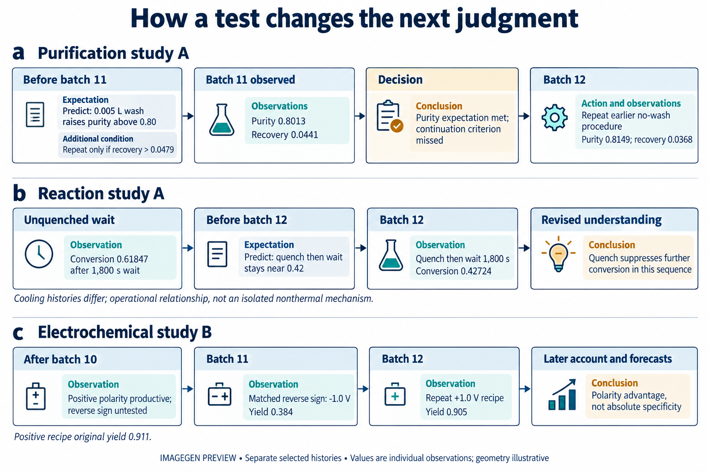
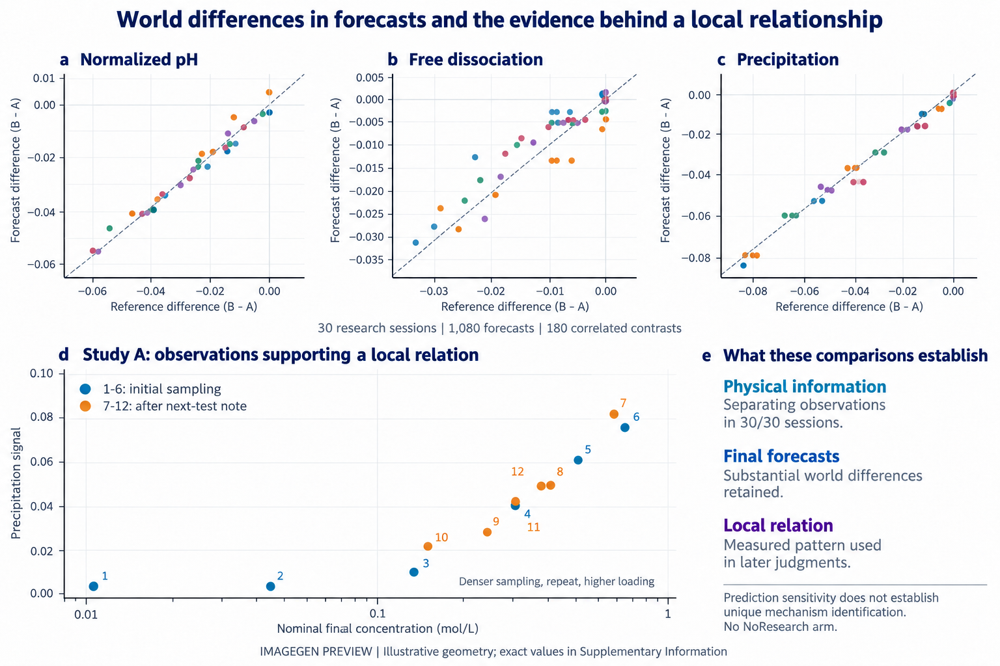

**自主科学的承诺，是将实验自主性转化为科学理解，但研究如何组织自身的证据基础仍缺乏理解。我们提出ChemWorld：智能体自主选择实验，而底层规律与信息供给可被独立控制的可编程化学世界。通过六个体系的重复研究与受控比较，我们连接研究条件、实验经历和后续判断。智能体检验预期、修订局部关系并根据结果选择后续实验；其解释也会改变资源使用与之后的证据机会。研究改善结晶预测，但同一研究历史中的源观测参照，在部分响应上优于研究者，在其他响应上则相反。点预测改善可以与不确定性估计恶化并存；平衡研究提高整体预测，却损害极稀区域的判断。这些发现区分了获取证据的收益、证据使用的预测价值与对未决条件的处理，为研究探索与科学理解如何相互塑造提供实证基础。**

科学发现能够引入理解现象的新方式，并由此开辟新的研究方向。爱因斯坦在1905年狭义相对论论文的开篇指出，磁体与导体相对运动的可观察效应，与当时理论描述中的不对称并不相称，随后提出原理并推演其对时间和运动的后果[@einstein1905electrodynamics]。提出值得进一步研究的解释性可能，是这一创造性活动的一个方面，也是反绎推理所关注的内容[@douven2025peirce]。更广泛地说，发展中的认识会改变研究者比较什么、哪些结果需要解释，以及接下来探索什么。

随着AI Scientist与自主实验室承担更多研究组织工作，这一联系成为具体的科学问题[@tom2024selfdriving; @boiko2023autonomous]。机器人科学家与自主实验室已经展示假设检验、材料发现和反应优化[@king2009automation; @burger2020mobile; @macleod2020selfdriving; @szymanski2023alab]，语言模型智能体进一步连接科学指令与实验室工具及操作[@bran2024augmenting; @dai2024mobile]。实验成功确立了一项成果，却不能单独说明研究者形成了什么关系认识，以及证据在多大范围内支持这一认识[@elmachtoub2022spo; @shmueli2010explain]。

自主研究者获得的证据，本身就是探索的结果。目标与已有知识影响实验选择；实验使特定现象可见，也消耗资源；由此形成的判断又可能改变后续研究方向。成功的实验可以支持有用的局部关系，失败的实验也可以排除一种预期并改变下一项决定。理解这一过程，需要同时追踪证据如何改变判断，以及判断如何改变继续获取证据的机会[@platt1964inference; @lindley1956information; @chaloner1995design]。

我们在ChemWorld中研究这些联系。核心问题是：当初始信息不足以决定答案时，智能体如何组织探索、发展科学理解，而这些理解又如何塑造后续研究？覆盖六个化学体系的四个互补矩阵连接研究目标与信息、连续研究经历、实验机会和匹配世界中的区分证据。我们在完整轨迹中追踪具体判断，并在重复会话间比较其后果，由此将研究的组织方式与其建立、修订和采用的关系联系起来。

## 使自主科学探索成为可检验的研究对象

ChemWorld将材料、操作和仪器组合为由热力学、动力学及耦合过程关系驱动的持续化学世界。反应、热处理、平衡、分离与结晶组件可以连接为多阶段流程。样品状态持续保留：上游反应或热历史会改变下游分离与测量。智能体在固定资源额度内选择数量、处理顺序、测量及后续实验；评价者独立控制世界参数与公开信息，记录实际提交的操作，并获得不向研究者公开的参照结果（图1）。

这一安排使证据选择与证据解释能够共同接受检查。知识测试和给定数据任务考察重要的科学能力[@mirza2025chembench; @majumder2025discoverybench]，交互式发现环境也已经将行动与观察连接起来[@wang2022scienceworld; @jansen2024discoveryworld; @gandhi2025boxinggym; @chen2025physgym]。ChemWorld使这些选择在可组合化学过程中可被核对。公开记录确定智能体看见和提出了什么，执行记录确定哪些干预改变了样品，独立世界响应检验后续预测。操作请求可能失败而没有产生预期实验；在一种条件下得到支持的关系，在另一条件下仍可能未决。

整合设计包含四个矩阵、450场计划研究。目标—信息矩阵包括电化学与反应处理各90场；过程矩阵包括分配、纯化、平衡和反应耦合结晶各45场；机会矩阵在平衡与结晶中分别比较有研究与无研究，每体系30场；另有30场使用匹配水相世界。最近实验块贡献300场，另外150场沿用早期固定协议，各块及其失败分别报告（方法；扩展数据图2）。

Opaque提供任务与操作合同，不附加实例资料；Aligned提供正确但不完整的信息；MisIndexed提供指定错配。发现任务强调研究科学关系，优化任务强调形成有效方案。世界、接口和额度按各固定块设计保持，每单元有三次独立开启的会话，模型采样随机种子不可控。这些对照规定研究的起始条件，实际路径由智能体组织。

实验结束后，研究者依次封存科学说明、在无实验室访问条件下预测十二项新干预，并在没有真值反馈时反思。我们将同期判断与实际操作、观察、修订和后续用途连接起来。全部300场新研究的公开经历均已阅读，包括不完整经历与失败检验；随后按解释内容选取示例轨迹。稳定的研究标签将下文核心案例与补充材料中的完整记录和关键时点对应。450场设计说明研究条件的覆盖；条件对照估计各自后果；精选经历证明具体转变实际发生过，不估计其普遍发生率。世界中成立什么、特定时点的证据支持什么，以及研究者实际采用什么判断，始终分别考察。

## 科学探索的自主组织与适应

目标与信息为研究提供不同起点，其后果取决于研究者实际探索什么。在重复电化学矩阵中，相较发现任务，优化任务使世界等权的推荐复测分数从0.4813升至0.5852，产率从0.1310升至0.4225；但分数、产率和法拉第效率的预测误差分别从0.1539、0.0665和0.1677升至0.1829、0.0781和0.2218，三个误差方向均见于全部五个世界（图2a、b）。形成更有效的方案，并不保证对新干预的判断更准确。

信息也产生分化的后果。反应优化任务中，Aligned相较Opaque使推荐分数从0.2735升至0.4429，产率从0.5502升至0.7116；风险预测误差从0.2389降至0.1226，而转化率误差从0.0355升至0.1595，四个方向均见于五个世界（图2c、d）。比较对象是完整的目标或信息条件。这些结果明确了需要解释的后果，并不将某条选定经历认定为其唯一原因。

纯化研究A直接展示结果如何改变研究组织（图3a）。无洗流程已得到纯度0.8140、回收0.0479；增加有机相量提高了回收，却使纯度停留在0.7886，低于要求的0.80。第11批之前，研究者预测0.005 L的小体积洗涤可以跨过纯度门槛，并事先规定行动标准：只有回收同时超过0.0479，才重复这一洗涤方案。这里区分了预期的科学响应与继续推进流程的条件。

第11批纯度达到0.8013，回收却只有0.0441。第一项预期实现，继续条件没有满足。因此，第12批回到较早的无洗流程，重复得到纯度0.8149、回收0.0368。终末说明承认合格状态可重复，同时回收存在变动；后续预测保留了观察到的纯度—回收权衡。研究者没有把一个响应的改善视为继续替代方案的充分理由。事前标准、实际检验与下一行动具有时间上的对应；接近阈值的洗涤结果仍是局部观察，不能据此认定稳健合格。

纯化研究B展示判断如何改变之后仍可获得的证据。前四批回收偏低后，研究者提出可能遗漏了一个投料组分，并说明后续会补入该组分。接下来四批实际使用两种投料命令，但两者消耗同一共享库存；库存耗尽使计划中的温度实验无法完成。终末笔记正确地将这些拒绝或空白操作排除于温度响应证据之外。该解释同时涉及化学与操作语义，但实际序列清楚：候选解释改变材料使用，材料使用改变剩余研究机会。记录没有将这一解释的作用与选择的所有其他决定因素隔离。

两条电化学经历进一步把任务比较与局部证据的不同用途联系起来。电化学研究A以匹配的正负极性比较开始：负电位产生响应，所测正电位条件基本不活跃。后续批次沿负侧细化材料和时长，终末笔记明确将极性结论限制于已测流程。然而，随后的数值预测仍给未经检验、位于已研究电位幅值之内的正侧条件近背景响应，区间没有覆盖参照结果。公开声明的适用边界与新判断中的实际应用可以分离。

同样承担优化任务的电化学研究B，则把极性依赖的范围变成了实验问题（图3c）。十批材料与时长研究之后，研究者记录正极性特异性的判断尚未经过匹配反向条件检验，并留出一次匹配反向检验和一次精确重复。其事前原句是：“If negative potential retains high yield, the assumed polarity specificity is rejected”（若负电位仍保留较高产率，就否定此前假定的极性特异性）。第11批在−1.0 V下仍得到产率0.384；正电位流程及其末批重复分别约为0.911和0.905。终末说明将认识从表面的极性特异性修订为极性优势，后续预测也保留反向产物。这是优化过程中实际发生的解释检验，形成了更有范围、仍然有用的关系。两条经历的世界和信息条件不同，因此展示的是不同路径，不是检验策略的随机对照。

三条核心轨迹提供互补证据：依照既有继续标准评价新观察、前瞻检验一项局部操作预期，以及修订科学关系的内容。它们不是同一种完整循环的三次重复。关键在于，一项判断是否改变了实际比较，以及结果随后被怎样使用。历史五模型平衡研究提供另一种对照：部分准确预测来自主动进入稀释区域，另一些则来自局部观察上的外推（扩展数据图7）。这些研究扩展了可观察路径的范围，但不增加当前矩阵的重复数，也不定义模型的固定性格。

## 科学认识在实验中的形成与演变

反应研究A追踪一项预期如何从观察进入新实验，再进入后续应用（图3b）。390 K、加热1,800 s后直接终止，转化率为0.41718；另一批同样加热后不立即淬灭，而等待1,800 s，虽然降温约44 K，转化率仍升至0.61847。研究者据此认为，停止外部加热并不等于化学变化结束。末批之前，它预测若先淬灭再等待相同时长，转化应保持在约0.42，而不是未淬灭等待的约0.62。

末批真正执行这一顺序，得到转化率0.42724。随后笔记保留了淬灭操作与抑制进一步转化之间的局部关系。这项新证据改变了研究者对哪一段处理历史仍具有化学后果的认识；后续预测将该关系用于新流程，但未观测溶剂和投料条件下的迁移仍较不准确。已经建立的进展是具体的：事前明确提出的操作比较，支持了一项有用的局部预期。

该比较支持已测操作顺序下的反应抑制，但没有将温度变化与其他可能作用分离（方法）。

匹配世界矩阵在独立控制底层化学的条件下考察相关问题（图4）。五对水相世界共享公开说明与部分参数，区别在于是否耦合额外中性离子对。将实际动作在配对世界重放，表明三十场研究均获得至少一个在两个响应通道上相差三倍测定标准差的观察。这量化了物理上可获得的信息；研究者是否认识到这些信息解决了什么，仍须放回实际经历中检查。

对全部三十场已有预测的事后分析，进一步检查最终判断是否保留配对世界的响应差异。对于相同查询，比较两世界各三场预测均值之差与原参照均值之差（图4a—c）。非零参照差异中，pH、解离与沉淀方向分别在54/57、48/57和39/39项上一致；其余3、3和21项参照差异为零，也全部保留于分析。参照差异达到三倍测定标准差时，分别为48/48、10/10和27/27，其余小差异也全部保留于分析。预测因而保留了明显的世界差异。这项结果考察预测，不能证明唯一机制识别或研究带来的独立增益：本块没有无研究组，起始观测也只是接近而非完全相同。

匹配世界研究A中，研究者事先提出：尖锐沉淀起始点和被缓冲的溶解响应将支持溶解度限制解释，而平滑变化也容许经验分配描述。六次测定之后，它提出更密集的浓度采样、中点重复与增加投料；后六批实施这些选择，十二次实际观察构成所用关系的证据基础（图4d；补充材料）。最终说明保留平滑单调关系，预测也明确表示，由于没有分辨出尖锐阈值，将采用这一关系。匹配世界研究B先提出将浓样从0.75 M稀释至0.375 M的响应预期，再执行稀释；归一化pH从0.08045升至0.10803。研究者支持近似可逆性，但最近的独立配制对照为0.4 M，沉淀读数也来自不同仪器。这些记录把明确的候选与实际比较、有范围的结论连接起来；单有物理区分力不能建立这种联系。

互补经历显示，认识也可以通过失败预期继续发展（扩展数据图8）。更强混合推翻暂定的分配平台；第四次结晶热循环没有延续第三次的改善；进一步稀释使可回收颗粒消失，收窄了原先设想的操作窗口。这些检验通过修订判断作出贡献，即使最终方案没有改善。实验未分离同时变化的因素时，它们各自的作用仍然未决。

我们在完整研究轨迹中追踪这些具体判断。同一会话中，一项有依据的修订可以与另一处未经支持的前提并存。支持案例涉及研究者如何重建实际做过什么：有的把回滚操作视为已完成检验，另一些则明确排除它们（扩展数据图6）。焦点加热案例的公开返回同时包含成功标识、明确回滚信息和零时间及温度变化。因此，后续解释涉及接口呈现与实验经历重建的共同作用，不能单独归为化学推断失败。方法与补充材料保留了这些冲突信号，并区分终末说明与在后续行动之前已经记录的前提。

这些经历中的认识发展，体现为实际比较、证据支持的关系，以及进入下一项决定的内容发生变化。它们是研究中相互连接的转变；最终答案正确或使用科学语言，都不能单独证明这些转变已经全部发生。

## 自主探索中科学进展的性质与条件

机会矩阵测量获得研究机会的后果。两个体系分别在五个固定世界、每组每世界三次新会话中，比较十二批研究与不开展源实验；两组共享Opaque信息与评价。该对照估计选择实验、接收反馈和记录判断这一完整机会包的作用。它补充过程记录，但不把差异归因于单一推理活动。

新结晶比较确立了明显的研究收益（图5a）。三十场均有有效预测。相较无研究，世界等权MAE在纯度上从0.13853降至0.01661，在粒径指数上从0.23619降至0.07641；回收误差从0.13532降至0.11579，细粉误差从0.37683降至0.30110。纯度的名义80%区间覆盖从0.46667升至0.98333，宽度从0.44744缩至0.09743。更窄的区间覆盖了更多参照结果，但高于名义水平的覆盖本身不能证明校准。这些虚拟世界中的研究经历大幅改善了后续判断。

同一队列也区分了更好的点预测与更好的不确定性估计（图5c）。细粉区间宽度从0.68500缩至0.38450，覆盖却从0.42778降至0.35556。兼顾宽度与漏覆盖惩罚的区间评分，世界等权均值从1.4794恶化至1.8047，全部五个世界均恶化。研究降低了细粉的平均点预测误差，但形成的区间表现出超出其实际表现所支持的确定性。收益与局限属于同一比较中的同一响应。

第二层比较考察同一批研究历史还能够支持怎样的预测（图5b）。十五场Research会话中，保留的源观测均值参考在纯度、粒径上的误差为0.00450、0.01786，均低于智能体的0.01661、0.07641，且两项均见于全部十五场。回收的方向相反：智能体0.11579优于参考0.18828，十五场中十四场更好。参考只使用本场公开源观测，并在相同目标上评分，拟合时不接收目标真值。它是在Research历史上使用另一种预测规则，不是第三个实验组，也不是学习的下一阶段。常数参考可能适合稳定响应，却不因此理解化学；智能体的回收优势同样不能证明其机制解释正确。两层比较共同表明，研究可以产生价值，但从观察中获得的预测价值随响应而异；它们并未将研究总效应作因果分解。较早修正版结晶的诊断则继续作为独立支持结果保留（扩展数据图3）。

保留的平衡机会比较揭示区域边界（图5d）。十四份有效Research预测与十五份NoResearch预测之间，整体归一化宏平均误差从0.132086降至0.035632，五个世界均改善；事前指定的三道极稀问题误差却从0.061467升至0.103677，四个世界恶化，其他九道则从0.155625降至0.012950。允许缺失的Research预测取合法范围内任意误差，也不会逆转两个总体方向（方法）。局部证据可以改善多数预测，同时使另一条件区域中的应用更不可靠。保留的平台关系历史展示了这样一种应用，但不构成总体逆转的唯一原因（扩展数据图5）。

信息比较进一步说明进展的条件。Aligned、Opaque和MisIndexed下，分配比例误差分别为0.04654、0.05621和0.07700，Aligned优于MisIndexed的方向见于全部五世界；纯化纯度误差则相近，约0.152—0.154，MisIndexed的回收误差最低。结合反应对照，这表明一份信息可以帮助某项判断，而不改善全部响应。历史先验与预算比较在独立队列中提供进一步边界（扩展数据图1；补充材料）。

定量与过程证据回答互补问题。机会比较确立研究可用时改变了什么；连续经历显示预期如何成为检验、结果如何进入选择，以及有用关系如何获得适用范围。目标与信息比较则说明这些后果依赖研究如何开始。在这些系统中，科学进展包含有效流程、可靠局部关系、成功迁移与恰当不确定性，它们可以在同一次研究中以不同方式发展。

## 讨论

自主研究通过塑造认识赖以形成的证据，参与塑造科学理解。纯化轨迹使这一联系具体可见。一位研究者将纯度预期的实现与继续方案的标准区分，并据此改变下一实验；另一位根据解释采取行动，耗尽库存，从而失去后来检验温度的机会。二者体现判断进入研究组织后的不同后果。证据获取依赖持续发展的研究，包括其目标、解释、资源和操作语义。

反应与电化学检验展示这种组织如何产生科学进展。差异观察引出前瞻比较；结果支持操作关系，或使看似绝对的关系变成有条件的优势。本文的实证贡献在于追踪这些活动实际建立了什么，以及所得认识如何被继续采用。局部关系可以指导研究，同时保留尚未解决的解释候选与应用条件。

结晶对照将获取证据的收益与有效使用证据区分开来。研究大幅改善纯度和粒径预测，同一批经历中的源观测均值又得到更低误差；回收率则在十五场中的十四场由研究者优于参考。因此，一种证据使用方式的价值取决于所预测的响应。细粉点预测改善与区间评分恶化并存。这些发现区分了获取证据的价值、证据应用的质量，以及对未解决条件的不确定性[@shmueli2010explain; @gneiting2007scoring; @ovadia2019uncertainty]。不能只凭最终流程成功或平均预测改善来推定科学理解。

这一分析也明确各设计能够解释什么。对照估计完整的目标、信息或研究机会条件，选定轨迹并不识别这些效应的唯一中介；匹配世界回放量化固定动作下的信息，而非另一种反馈如何改变下一行动。独立的固定配方淬灭比较测量物理后果，不含研究者适应（扩展数据图4）。明确各类证据的贡献，使论文能够解释认识的实质性发展，而无需为每个案例指定同一因果机制。

证据限于可编程世界，重复矩阵还限于一种模型配置。新会话不是受控模型随机种子的重复，也不是化学规律的独立抽样。公开笔记定位的是已表达的判断而非内部认知，中间表述缺失限制时间推断。全部新公开经历均已阅读，七条具名历史另经引文、时序、实际比较与后续用途的内部核对；选择与解释仍是事后的、非盲的，缺乏独立人类第二评分者验证。所附原始公开材料支持此类复核，但不替代复核本身。接口歧义作为研究环境的一部分保留，不全部归因于科学推理。这些边界界定了当前比较和记录能够支持的结论。

ChemWorld为研究自主探索如何形成自身的证据基础提供实验条件。研究者不仅积累观察，也改变比较什么、哪些关系被视为获得支持，以及接下来如何研究。理解这一发展过程，将实验自主性的承诺连接到可直接研究的科学问题：探索如何产生可靠认识，而这些认识又如何使进一步探索成为可能。
