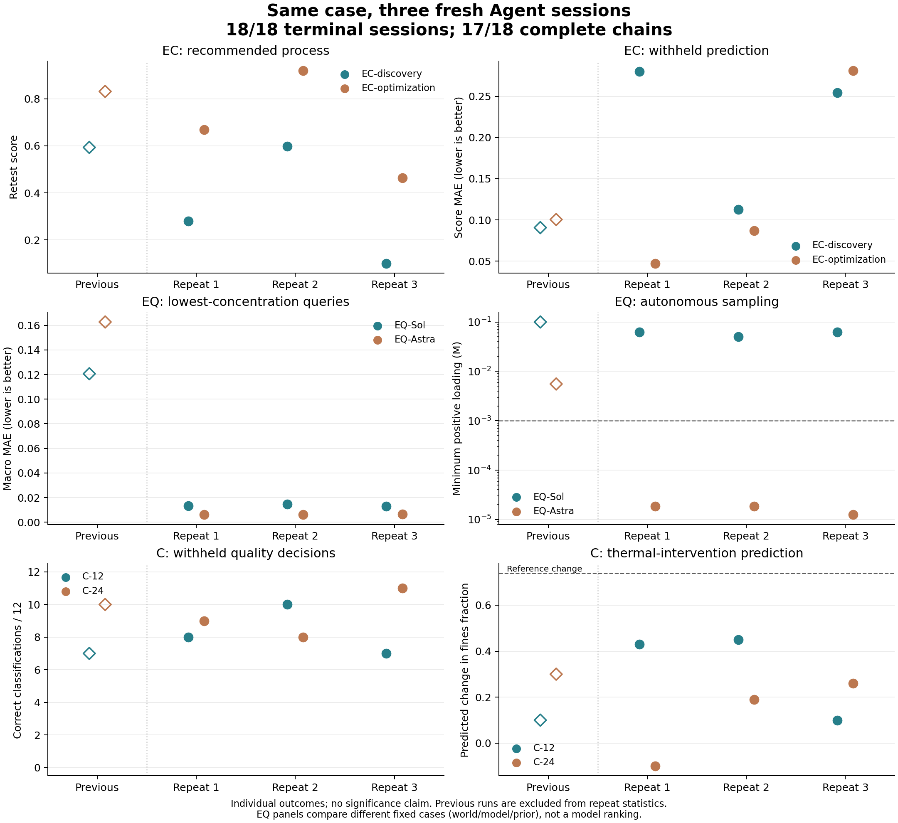

# 六案例同世界重复：完成后的稳定性分析

2026-10-13，W2-247。六个案例各新增三次独立会话，18/18 达到终态，252/252 个源实验
批次完成；17/18 条后测链完整，58/60 项后测封存。第一轮 Astra 的 K2 提供方失败、
EQS 未执行；该条的源实验与 Q 预测有效，保留在对应统计中，没有补跑。

本次支持的结论是：**部分操作表现会重复出现，但研究路径、解释与预测能力并不一起
稳定。笔记让这些差异可核对，也会记录错误的执行叙述。** 三次是小样本描述，不能宣称
总体显著性或估计笔记的因果收益。此前六案例独立展示，未混入本次均值和标准差。

[固定设计及并发调整](../../WORK_II_CASE_NOTEBOOK_STABILITY_20261013.md) ·
[完整逐次表及笔记入口](REPORT.md) · [机器汇总](summary.json) ·
[结果图 PNG](stability.png) / [SVG](stability.svg) ·
[本机工作台](http://127.0.0.1:8894/?view=records)

## 什么保持相同，什么不相同

每个案例内固定当前核心、物理世界、初始状态、模型与 medium 设置、先验/公开信息、
目标、预算、笔记角色、观测噪声映射和后测题库。三轮输入配置相同，432 个参考批次
计算出的答案逐值相同。自主操作和因此见到的观测可以不同；这不是强制重放同一动作。

原生提供方不开放可控的模型采样 seed，所以准确名称是“同条件独立会话重复”，不是
可复现模型随机种子的多 seed 实验。最初串行，用户随后要求 4 或 8 并发；实际在
11 条终态、144 批已完成时切换到最多 4 并发，保留在途第二轮 C-24 进程。模型与物理
执行代码未改，无会话重启；并发段约 26.6 分钟完成剩余会话。服务负载和日历顺序并未
控制一致，不能把第三轮差异单独归因于模型随机性或并发。

同一轮仅用于组织比较，不代表匹配了两条会话的提供方随机数。特别是 Sol 与 Astra
分别处于 W01/Opaque 和 W03/MisIndexed，不能用这两行作模型排名。

## 电化学：操作得分方向重复，预测优势并不一致

下表均为新三次；SD 为样本标准差，n=3。推荐分数来自固定规则的独立复测，MAE 来自
12 道封闭预测题，越低越好。

| 指标 | 第一次 | 第二次 | 第三次 | 均值 ± SD |
| --- | ---: | ---: | ---: | ---: |
| 发现：推荐得分 | 0.2807 | 0.5984 | 0.1006 | 0.3266 ± 0.2520 |
| 优化：推荐得分 | 0.6690 | 0.9195 | 0.4631 | 0.6839 ± 0.2286 |
| 发现：得分预测 MAE | 0.2799 | 0.1127 | 0.2545 | 0.2157 ± 0.0901 |
| 优化：得分预测 MAE | 0.0472 | 0.0867 | 0.2812 | 0.1384 ± 0.1253 |

优化推荐得分在三个轮次都更高（3/3），预测误差只有 2/3 更低。第三次优化的预测
MAE 反而较高，80% 得分区间仅覆盖 2/12 题；前两次覆盖 10/12、11/12。因此可以保留
“高分操作与跨条件预测是不同终点”，不能写成“优化总能改善预测”或“预测总无改善”。

两种目标的绝对得分都明显波动，范围分别为 0.1006–0.5984、0.4631–0.9195；不能仅用
3/3 的组间方向把每个案例自身描述为稳定。此前单次得分 0.5933/0.8311、MAE
0.0906/0.1005 单独见图，不替换也不隐藏。

笔记帮助解释采样差异，但不证明机理。发现组第一次和第三次早期比较 ±1.5 V，
随后形成偏向负电位的局部叙述；第二次早期比较 ±1 V，形成正电位窗口的经验模型。
相同世界下，选到不同位置可以形成不同局部概括，不能把某一次电位叙述提升为全域
规律。原文见 [第一次](repeat-01/EC-discovery-notebook.md)、
[第二次](repeat-02/EC-discovery-notebook.md)、[第三次](repeat-03/EC-discovery-notebook.md)。

## 平衡：本次三次较一致，先前的外推失误没有稳定重现

最低三题沿用 Q03/Q08/Q09：每条会话有 9 个指标预测，区间覆盖分母为 45 个参考观测。
这些参考观测不是 45 个独立 Agent。浓度仅统计普通正投料，component 替代另列。

| 固定案例与指标 | 第一次 | 第二次 | 第三次 | 均值 ± SD（误差） |
| --- | ---: | ---: | ---: | ---: |
| Sol：最低取样浓度，mM | 62.5 | 50.0 | 62.5 | — |
| Sol：最低三题 MAE | 0.01332 | 0.01453 | 0.01288 | 0.01358 ± 0.00086 |
| Sol：最低三题覆盖 | 45/45 | 45/45 | 45/45 | — |
| Astra：最低取样浓度，µM | 18.52 | 18.52 | 12.50 | — |
| Astra：最低三题 MAE | 0.00611 | 0.00607 | 0.00644 | 0.00621 ± 0.00020 |
| Astra：最低三题覆盖 | 45/45 | 41/45 | 40/45 | — |

Sol 三次都未进入 1 mM 以下；Astra 三次都进入。Sol 的笔记把高浓度平台结论限定在
已测范围；Astra 三次均写下从平台转向稀释区的检验和约束条件。这是本次固定案例中
重复出现的路径差异，不能外推为普遍模型特性。

此前单次最低三题 MAE 为 Sol 0.12062、Astra 0.16267；Astra 当时最低普通投料
5.56 mM，最低三题区间覆盖 0/45。本次三次均未重现那种程度的外推失败。因此原先
“高浓度局部描述遇到稀释外推就会失败”的强概括应收窄为个别运行的现象。三次新结果
也不能抹掉此前不利结果，或证明笔记导致了改进；条件中没有无笔记对照。

第一轮 Astra 缺 K2/EQS，但 Q 已有效封存，所以预测统计仍是 n=3，而完整报告链只有
2/3。区间覆盖与宽度一起保留在机器表中，不能把宽区间的高覆盖当作高精度。

## 结晶：推荐可行性改善，解释迁移仍有明显缺口

推荐质量按宿主无噪声值检查：纯度至少 0.80、细粉不高于 0.50；六条推荐的回收率均
超过 0.10。不给失败推荐填零，也不把只有可行条件的平均值冒充全部推荐均值。

| 指标 | 12 批：三次结果 | 24 批：三次结果 |
| --- | --- | --- |
| 推荐质量可行 | 否、否、是（1/3） | 是、是、是（3/3） |
| 推荐真实回收率 | 0.4710、0.4476、0.5099 | 0.4512、0.6484、0.5610 |
| 推荐真实细粉比例 | 0.99994、0.59354、0.35890 | 0.48735、0.28085、0.44455 |
| 12 题质量分类正确数 | 8、10、7 | 9、8、11 |
| 热干预细粉变化预测 | +0.43、+0.45、+0.10 | −0.10、+0.19、+0.26 |

24 批组的推荐可行性在本次更一致，质量分类却只在 2/3 轮更好。第一轮推荐的细粉
余量仅 0.01265，后两轮为 0.21915、0.05545，不能把三次可行等同于高概率稳健达标。
12 批组前两次笔记明确承认推荐是不满足细粉限制的备选；不利结果全部保留。

全部 12 题的误差进一步显示，增加实验预算不保证所有预测变好：

| MAE，均值 ± 样本 SD，n=3 | 12 批 | 24 批 | 24 批较低的轮次 |
| --- | ---: | ---: | ---: |
| 回收率 | 0.04646 ± 0.01020 | 0.14257 ± 0.05268 | 0/3 |
| 纯度 | 0.05139 ± 0.03089 | 0.01668 ± 0.00433 | 3/3 |
| 粒度 | 0.02935 ± 0.01552 | 0.06470 ± 0.02624 | 1/3 |
| 细粉比例 | 0.28425 ± 0.07441 | 0.30184 ± 0.06118 | 1/3 |

热干预参考变化固定为 **+0.73855**（0.26145→1.00000）。六次都低估变化幅度，
24 批三次的变化误差为 0.83855、0.54855、0.47855，12 批为 0.30855、0.28855、
0.63855。此前单次 24 批优于 12 批的热预测幅度优势，在新重复中只出现 1/3。
“有同期热历史解释”仍不能等同于“能定量预测另一个热程序”。

原评估器将细粉变化的绝对值 ≤0.10 判为未分辨，因此两组机器输出的“方向正确”
都是 2/3。第三次 12 批的正变化约 +0.10 落在分辨边界，不能被叙述成预测了反方向。
保留原始数值和既有评分实现，不为更有利的方向计数改变阈值；浮点边界上的二元
差别不作为科学发现。

## 笔记提供了什么证据，也暴露了什么问题

18/18 会话在第一步物理操作前写了初版，合计 65 个版本，全部版本游标和已提供的
事件引用有效。各案例版本数依次为：发现 3/3/4，优化 3/4/4，Sol 2/2/2，Astra
4/4/5，结晶 12 批 2/3/5，结晶 24 批 4/6/5。**主动回读工具调用仍是零**；当前结果
不验证上下文压缩或新会话中依靠笔记恢复研究的能力。

笔记中确有可核对的前瞻记录。例如 [第三次 Astra](repeat-03/EQ-Astra-notebook.md)
在等浓度小体积尝试失败后，先明确承认等待/终止/终检均未提交成功，再记录同一容器
等浓度扩容的修正计划，最终取得有效终检。这里改变的是模型自主选择的操作，既定
实验规则没有被协调者修改，也不是重启该会话。

另一例更能说明笔记不能替代执行记录。[第二次 C-24](repeat-02/C-24-notebook.md)
写到了 0.50 g 与 1.0 g 总种晶量，并据此讨论种晶策略。实际 451 次加种晶请求中，
只有 24 次成功、427 次因 `payload_bounds:seed_mass_g` 回滚；24 个批次每批实际
成功加入的种晶都只有 **0.05 g**。机器汇总各案例的 `seed_execution` 保存逐批成功
投料和拒绝数。因此该次不能支持笔记声称的种晶剂量比较；热历史与材料选择可以
继续根据成功执行的动作审查。未把失败请求解释为已加入的物料，也未改写模型原文。

该条最终推荐可行且回收率较高，但消耗 754 次操作、427 次回滚。三条 24 批会话的
操作数为 425/754/269、回滚数为 8/427/23，说明固定批次数不意味着研究成本或行为
效率相同。笔记把假设、修订和错误叙述留下来供核对；版本多、文字谨慎或有事件引用，
都不足以证明科学解释正确或导致了性能改善。

## 完成、资源与保留范围

- 源实验：18 条、252 批、3,019 次操作、486 次回滚；18/18 轨迹精确回放。
- 参考计算：432 批、2,757 次操作、69 条轨迹全部精确回放；三轮答案一致。
- 推荐复测：12 批、149 次操作、12/12 轨迹精确回放。上述合计 696 批、5,925 次
  操作、99 条轨迹，与 Agent 独立会话分母 18 区分。
- 后测：58/60；第一轮 Astra 的 K2 为 `provider_failure`、EQS 未执行。所有 18 份
  Q 有效。7 次笔记工具错误、1 次已恢复的实验工具传输错误与所有回滚均保留。
- 每条源会话仅启动一次，共 18 次。17 条 token 账目完整；已观测输入加输出为
  19,205,936 tokens，含缓存。Astra 失败阶段用量缺失，不能把合计当完整用量或美元成本。
- 第一次协调器启动在任何模型源会话前因进度计时错误停止，另存于 `attempt-01`：
  0 个参与者会话、60 次参考终检、548 次操作、16 条已验证回放。该次参考成本独立
  保留在 `startup_attempt_separate`，没有混入新 18 条统计。

原始记录在仓库外 `D:/Projects/ChemWorld-local-research/20261013-paper-case-stability/attempt-02`；
仓库仅保存脱敏结果、模型主动提交的笔记/报告和汇总。本机
[8894 工作台](http://127.0.0.1:8894/?view=records)共 24 条记录：原六条与新增十八条，
失败链明确标记且仍可查看。原 8893 服务未重启：此前重启动作被自动审批拒绝，仅返回
`blocked by policy`；本次采用新目录、新端口完成阅览交付。

本块作为当前核心上的描述性开发证据，未替换历史数据、未修改论文/PDF，也未自动
升级为正式稿件证据。后续若要研究笔记的因果收益、长程恢复或控制并发影响，需要另设
相应对照；本次不事后添加这些条件。
