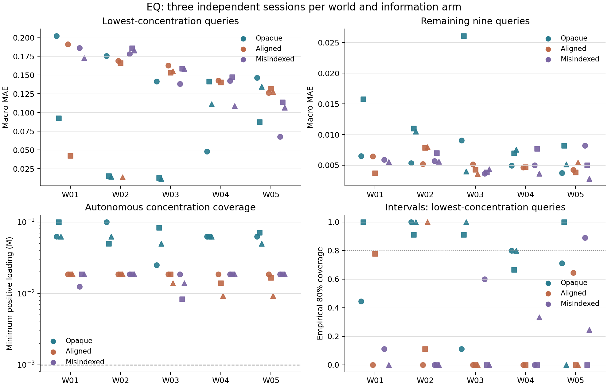
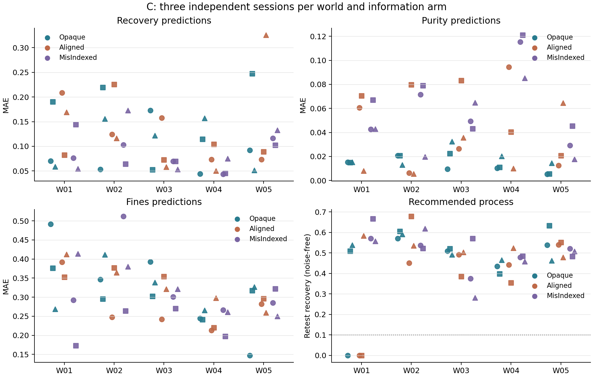
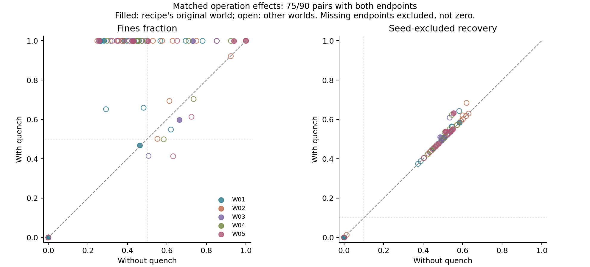

# 覆盖扩展与匹配淬灭：完成结果

新增 42/42 场结束，40 条完整链；源批次 503/504、封存阶段 136/141。与既有 48 场合计 90/90 场、84 条完整链。
原四条后测失败继续保留；新增失败不替换。没有受控模型 RNG seed，也未更换模型。

## 覆盖扩展

下表为五世界等权描述均值；个体值、有效分母和样本 SD 见完整分析。新加入的信息臂和原信息臂并非同时执行，因此这些差异包含时期/提供方漂移的可能影响。

| 响应 | Opaque | Aligned | MisIndexed |
| --- | ---: | ---: | ---: |
| 平衡最低浓度三题 MAE | 0.098801 | 0.13205 | 0.14848 |
| 平衡其余九题 MAE | 0.0090677 | 0.0051239 | 0.00531 |
| 平衡最低三题区间覆盖 | 0.73852 | 0.19481 | 0.14889 |
| 结晶纯度 MAE | 0.015366 | 0.041205 | 0.059638 |
| 结晶回收 MAE | 0.1201 | 0.12875 | 0.088207 |
| 结晶细粉 MAE | 0.31773 | 0.30873 | 0.30062 |
| 结晶推荐质量与回收同时达标比例 | 0.6 | 0.46667 | 0.93333 |

新增覆盖回答结果是否依赖世界与信息条件，不自动建立某一统一的认识形成机制。全部笔记、动作与分阶段报告均导出；本自动汇总没有把新增文本冒充逐句人工精读。

## 匹配淬灭

完成 180/180 条轨迹、90/90 对，有效成对测量 75/90。失败执行保留，缺测不填零。

18 条原推荐在原世界：有效 15 对；无淬灭达到质量与回收 8，有淬灭 1；细粉因淬灭增加 12 对、减少 1 对。平均细粉变化 0.35283，回收变化 0.0081978（有−无）。

五世界交叉：有效 75 对；无淬灭达到质量与回收 34，有淬灭 4；细粉因淬灭增加 57 对、减少 9 对。平均细粉变化 0.30937，回收变化 0.0074074（有−无）。

这里固定了其余操作，可以讨论所测配方内淬灭操作的总效果。温度、反应停止、后续相态和资源后果仍是同一干预的组成部分，尚未被分别隔离。这些因果结果解释环境中的工艺差异，不能替代智能体判断形成的时间证据或因果证据。
缺测分为无淬灭臂失败 5 条、有淬灭臂失败 10 条。本批次分别涉及无颗粒可测、以及淬灭后原定冷却目标高于当前温度。因此后续可执行性也是操作干预的结果，以上数值只描述完整配对。

[全部研究记录](REPORT.md)；[逐世界分层分析](ANALYSIS.md)；[每对淬灭数据与失败](QUENCH.md)。

