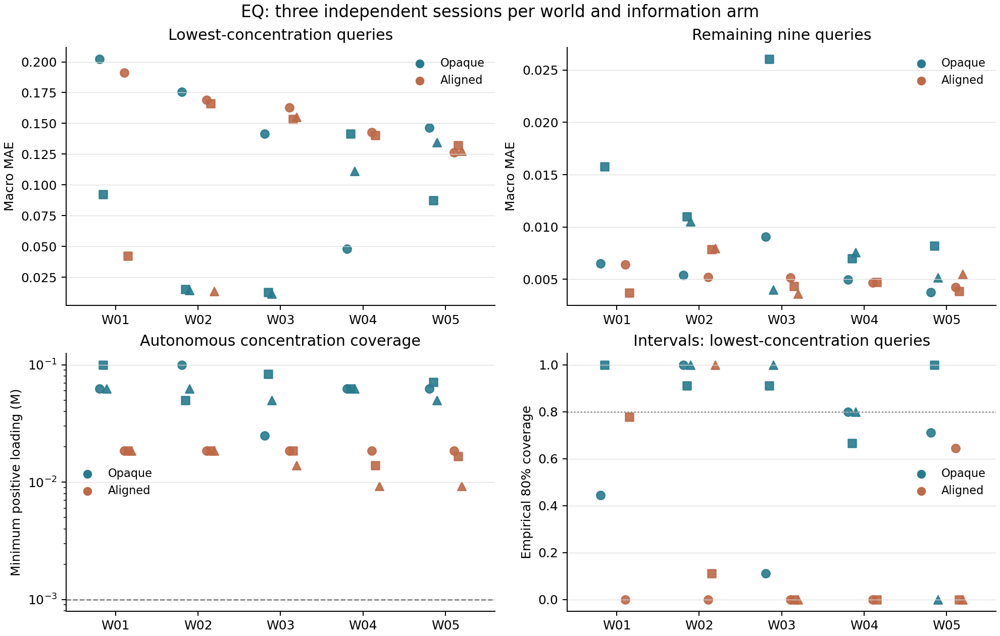
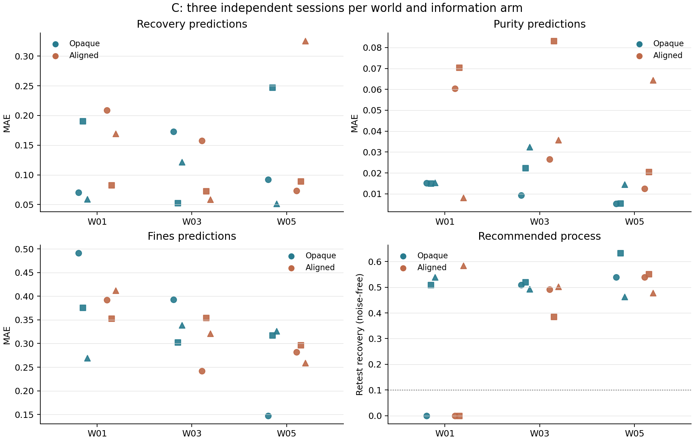

# 48 场同期笔记研究：结果与解释

固定队列已全部结束。

后续 W2-250 已完成全部 145 版源笔记的全文精读，并按相关判断对照 48 场后测。见[完整过程分析](CLOSE_READING.md)与[48 场逐场解释及引文](CASE_READINGS.md)。新增分析包含淬灭路径关联、局部关系到远端预测的转变，以及公开决策规则与实际选择的对照。下文保留首轮定量汇总和当时四条选例的阅读范围；实验结果及原评分未改变。

本块 **48/48 场到达终态，44/48 条完整链，576/576 个源批次，162/174 个有效封存阶段**。全部失败保留，没有按结果补跑。

研究对象为同一个 Sol medium 在固定世界中自主选择实验、记录判断并完成后测。EQ 覆盖五世界 × 两信息条件 × 三次会话；结晶覆盖预先选定的 W01/W03/W05 × 两条件 × 三次。这是一块独立的当前核心证据，不混入旧稿 300 场或此前 24 场笔记案例。

## 主要定量结果

**平衡的适用域差异：**最低浓度三题的平均误差为其余九题的 **10.896 倍（Opaque） / 25.772 倍（Aligned）**。这两个量同样来自封存预测，但对应不同干预范围；是否存在有依据的可迁移关系，需要结合来源证据和公开判断核对，而不能由单一总分回答。

平衡最低浓度三题 MAE：Opaque **0.098801**，Aligned **0.13205**；按世界均值，Aligned 较低/相同/较高为 1/0/4 个世界。

平衡其余九题 MAE：Opaque **0.0090677**，Aligned **0.0051239**；按世界均值，Aligned 较低/相同/较高为 5/0/0 个世界。

本块最低浓度三题的 A/O 误差比为 **1.3366**。这是本块世界等权的描述性比值，不能直接当作原稿 8.7 倍效应的同版本复验，也不能把跨版本变化归因于笔记。当前核心、记录职责及全新服务端轨迹均须保留为比较边界。

平衡最低浓度三题区间覆盖率：Opaque **0.73852**，Aligned **0.19481**；按世界均值，Aligned 较低/相同/较高为 5/0/0 个世界。

区间覆盖与区间宽度一起解释，逐响应宽度见完整表；覆盖率来自固定查询与参考观测，不当作独立样本上的总体校准率。

30 场平衡中，进入既定 1 mM 以下区域的是 **0/30** 场，另有 0 场无可用浓度记录。阈值是已有描述性分组，不是科学能力门槛；未直接进入某一区域不等于没有理论依据，准确外推也不自动证明本次研究形成了该知识。

结晶纯度 MAE：Opaque **0.014962**，Aligned **0.042435**；按世界均值，Aligned 较低/相同/较高为 0/0/3 个世界。

结晶回收率 MAE：Opaque **0.11754**，Aligned **0.13747**；按世界均值，Aligned 较低/相同/较高为 1/0/2 个世界。

结晶细粉比例 MAE：Opaque **0.32913**，Aligned **0.32349**；按世界均值，Aligned 较低/相同/较高为 1/0/2 个世界。

结晶纯度平均有符号误差为负的会话 **16/18**；这是低估方向的描述，误差量级和逐世界分布见详细表。不能只凭方向将轻微偏差、明显偏差与同一形成机制等同起来。

推荐独立复测满足纯度与细粉质量条件 **13/18**；同时达到回收率 ≥0.10 的 **10/18**，缺失复测 0 场。质量与有效回收必须分别报告。

## 重复性怎样理解

每个世界/信息条件只有三次会话，逐次点图和均值 ± 样本 SD 同时保留。世界差异与同世界会话波动分开呈现；没有使用题目数膨胀样本量，也没有提供可靠总体成功率或预先不存在的显著性结论。模型端无可控 RNG seed，不能称作严格相同模型随机种子复现。

EQ 十个条件中可计算的最低浓度误差样本 SD 范围为 **0.0018385–0.1054**（10/10 条件）；每格三次的数值与缺失数见 [定量分析](ANALYSIS.md)。一次轨迹中出现的解释、探索深度或反例不作为模型固定倾向。

每个点是一条会话；圆、方、三角分别为重复 1、2、3。横轴为世界，颜色为信息条件；缺失值不补零。源研究与推荐复测、后测分别计数。

## 笔记实际补充了什么

保留 **145 版笔记**，初始记录早于物理操作 48/48；在完成第 1–11 批之间有版本更新的会话 34/48；主动读取 0 次。这些是记录覆盖情况，不是科学质量评分。若只有开始与结束两版，只能定位公开判断的前后差异，不能声称记录了中途每一步认识变化。

下面四条是初次汇总时逐段阅读并核对成功执行记录的首轮案例，选择目的是说明不同过程，不据此估计发生频率。当时其余 44 场只保留完整模型原文和定量结果；后续全覆盖精读及其具体范围见上方 W2-250 链接，不将初次选例追述为全量编码。

**局部研究形成了有范围的描述，但这与未见条件预测仍是两项不同的结果。** 首轮 EQ-W01/Opaque 在操作前提出浓度控制与弱酸趋势，完成 0.0625–2 M 的矩阵后，把强方向性主张改为限定在该区域的近平台描述，同时保留替代解释和测量噪声。其最低浓度三题 MAE 为 0.20238。笔记明确写出了范围，不能把后测误差改写为它已经宣称平台普遍成立。这条轨迹揭示的是公开描述、证据范围与具体预测需要分别核对。[笔记](repeat-01/EQ-W01-Opaque-notebook.md) / [后测](repeat-01/EQ-W01-Opaque-reports.md)。

**先验可以成为被实际检验的局部命题。** 首轮 EQ-W01/Aligned 先记录档案中 0.001 mol、0.018→0.054 L 的预期，再按该对比操作；两批最终读数的 pH_normalized 变化约 +0.00444、解离率变化约 +0.01230。笔记将其称为局部相容，并未排除相关校准或其他响应面的解释。与此同时，该场最低浓度三题 MAE 为 0.1914。这里可以连接先前表述、实际检验与后来的适用范围；尚不能据时序证明这份表述造成了全部后续决策。 [笔记](repeat-01/EQ-W01-Aligned-notebook.md)。

**一次反向结果与随后收缩的公开判断。** 首轮 C-W03/Aligned 的第 11 批用 0.020 mol 得到细粉约 0.591、回收约 0.492；第 12 批进一步降至 0.010 mol 后，细粉升至约 0.846、回收降至约 0.402。最终笔记明确撤回单调改善的概括，把内点最优保留为待检验可能，并承认所有批次均未合格。该轨迹提供一种有同期依据的范围收缩；一次、部分混杂的对比并未建立普遍机理。 [笔记](repeat-01/C-W03-Aligned-notebook.md)。

**失败目标也可以被如实保留。** 首轮 C-W01/Opaque 原先预计极稀条件可能同时降低细粉并保留 >0.10 回收；第 12 批公共读数的细粉约 0.002、回收仅约 0.003。最终笔记只保留质量改善，明确没有得到满意回收。其独立复测的无噪真实回收为零，与接近零的带噪公共读数分别呈现。不能将这个条件写成完整成功，也不能忽略研究者实际承认了未达目标。 [笔记](repeat-01/C-W01-Opaque-notebook.md)。

## 对论文主线的含义

本块将可核对的对象从最终分数推进到：一个公开判断提出时掌握哪些信息，实验实际支持了什么范围，以及它随后如何被保留、修订和用于回答。数据同时包含正确的范围限定、未定解释、局部验证和外推偏差，适合支撑对自主科研中认识形成的研究。

不能把所有预测错误统一命名为研究过程中形成的误认，也不能预设自我确认循环。特别是已有明确边界声明的案例，后测出错并不直接证明模型认为自己建立了普遍规律。本块没有受控早期历史分支、无笔记对照或强制纠错条件，因此不承担这些干预的因果结论。形成机制的具体归因仍需对应证据，而不是由故事结构提前指定。

## 完整性与可复核性

源轨迹回放 48/48；参考 336 批、28 条回放；推荐复测 18 批；源操作 5031，回滚 134。有效 Q 45/48，不完整链 4 条，逐条原因见定量表与 JSON。

主文未在此自动重写。数据生产阶段的设计、世界、预算和停止规则保持不变；本次增加的纯度有符号误差和记录时点汇总明确属于事后描述分析。原始 provider 数据和凭证留在仓库外，Git 中只保留科学导出、分析代码、图表和说明。

- [全部 48 场笔记与后测索引](REPORT.md)
- [完整分层定量表](ANALYSIS.md)
- [机器分析结果](analysis.json)
- [固定实验说明](../../WORK_II_RESEARCH_FORMATION_20261013.md)
